# KWinHub 项目全景与一期流程图册

**版本：V0.3｜日期：2026-11-03｜状态：架构评审稿**  
**依据：KWinHub PRD V1.2 中文评审稿及 2026-10-29 立项会。**

本图册用于建立团队对产品、职责、数据与交付边界的共同理解。所有图均为目标设计，不代表已实现、已部署或已批准。以本会话交付的 PRD V1.2 为输入，本轮未重新审计 GitHub 最新代码。PRD 本身尚未冻结；图册不能替代接口契约、安全设计、数据表设计及容量评估。

建议仓库位置：`docs/architecture/kwinhub-project-blueprint-v0.3-zh-CN.md`；建议 PRD 位置：`docs/product/kwinhub-mvp-prd-v1.2-zh-CN.md`。在两个文档中互相添加相对链接。此为建议路径，本次未写入仓库。

## 本轮复核与版本衔接

复核输入为本会话已交付的 PRD V1.2、图册 V0.1（含注册流程）和后续用户确认。GitHub 对此前建议的两个新版文件路径返回未找到，文件搜索也未定位到，故不声称已审阅仓库当前最新版；本轮同步修订 PRD V1.2 修订 2 与本图册；未修改仓库代码，也未声称目标架构已经实施。

**用户已确认：** 阿里云部署、有现存 ECS 但倾向新购容器承载资源；约 300 家机构；以 1,000 人同时在线估算；视频上传并在在线报告中播放。**技术建议/架构决策：** Platform.Api 与 Hub.Api 两个独立 API 项目/部署单元；各自内部模块化组织、轻量 DDD、独立 Worker、托管 MQ、Outbox、私有 OSS 与 VOD/CDN。**尚未确认：** 地域、机器规格、用户活跃频率、同时上传/播放量、视频编码/大小/保留、认证源、云服务实际购买选型。

| 原文位置 | 复核结论及当前处理 | 后续动作 |
|---|---|---|
| PRD §4、FR-08、D-02 | 视频仍是 D；与后续已确认范围不一致 | PRD 下一版改为支持上传及在线播放，具体配额/格式待定 |
| PRD FR-06/07、§5B | 已有元数据与附件部分失败原则，但未明确双上传及云端媒体处理 | 按图 8 补充关联 ID、状态、完成核验及重试契约 |
| PRD FR-10 | 主要描述报告导出，未明确在线报告内播放器 | 补充在线展示、视频授权及状态；不把 PDF 当播放器 |
| PRD §7/8/9 | 缺少媒体任务、消息投递和消费恢复规则 | 增加 Outbox、消费记录、任务版本、回调收件与核对 |
| PRD §10、D-14 | 容量未确定 | 300 机构与 1,000 在线作为规划输入；RPS、视频吞吐及 RPO/RTO 仍须冻结 |
| 图册图 2/5 | 原图仅存储和普通同步，不能解释媒体可播放状态 | 本版更新逻辑图、保留恢复图并补充独立状态 |
| PRD 算法边界 | App 科学计算、Hub 基础统计仍有效 | 保持；视频转码不属于运动指标重算 |

## 技术架构总图与概念说明

本节更新为 V0.5 架构。下方直接内嵌 Mermaid 源图，避免仅下载 Markdown 后因缺少同目录图片而显示空白。预览器需支持 Mermaid；若当前阅读器不支持 Mermaid，请使用支持 Mermaid 的 Markdown 编辑器查看下方源码。

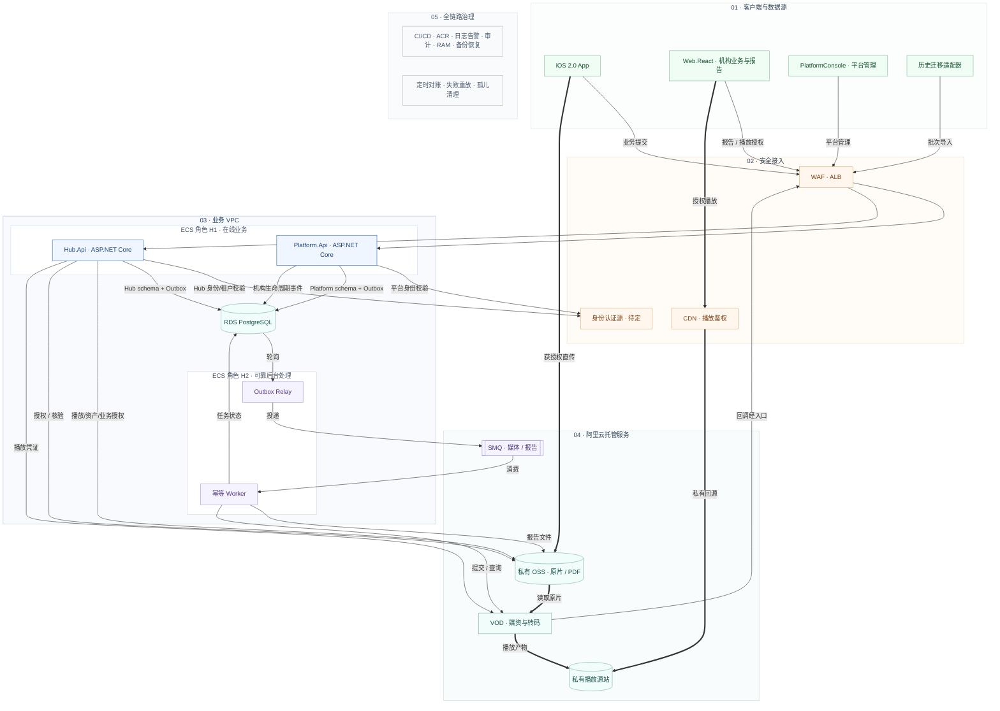

**视觉图例：** 绿色为客户端，橙色为安全接入，蓝色为在线业务，紫色为异步任务，青色为数据与媒体。细线表示业务与控制调用，粗线表示文件或媒体传输；底部治理能力覆盖全链路，不逐项连线。

**图中简写：** Platform.Api 与 Hub.Api 是两个独立 API 项目/部署单元；Platform.Api 管理全局机构生命周期和平台治理，Hub.Api 管理机构内业务及租户资源授权。RDS 可先共用集群，但 Platform/Hub 使用独立 schema、DbContext、迁移和数据库写权限；Outbox 事件由 Relay 可靠投递。H2 的 Worker 同时承担受控并发、报告生成和媒体任务协调。SMQ 为候选产品，媒体与报告采用独立队列。身份登录、回调认证、补偿查询和删除治理的细节见下方说明及图 8；总图只保留主要依赖。

**读图说明：** 箭头表示不同链路的调用或数据关系，并非单一顺序；运维治理对各层生效。先提交测试数据，视频独立上传；API 核验视频后，才在同一本地事务中更新媒体状态并写入 Outbox。报告可先查看，视频单独显示上传中、处理中、可播放或失败。CDN 回源到实际媒体产物存储，不回源 VOD 控制接口。

**可靠处理约束：** MQ 至少一次投递，Worker 必须幂等。提交转码后先持久化外部任务标识，再确认消息，不占住消息等待整个转码过程。回调须认证、去重及校验任务版本和删除标记；定时查询补偿丢失回调。自有 OSS 注册与受控导入应按实际接入条件选择，避免重复触发转码。


以上是建议部署目标，不是现网审计结果。两个 API 项目应可独立构建、配置、发布、回滚和扩容；各自保持无状态。初期可部署在同一 ECS/容器集群，但部署单元、配置、健康检查和发布流水线必须独立。若采用多个 API 副本，须无状态化并使用各自拥有的持久化边界；同一 ECS 上多容器并不提供主机故障隔离。是否采用双 ECS、跨可用区数据库和何种可用性目标，按预算及恢复要求另行确认。

| 概念 | 在本项目中的含义 | 一期采用方式 |
|---|---|---|
| 容器 | 打包与运行单位 | ECS 运行 API、Web、Worker；ACK 不是必要前置 |
| 双 API 项目 | Platform.Api 与 Hub.Api 是独立构建/部署单元 | 平台治理与机构业务有清晰边界；两个 API 不代表全面微服务化 |
| 模块化单体 | 每个 API 内按 bounded context/模块组织业务 | Hub 内部人员、测试、方案报告、媒体；Platform 内部机构生命周期、全局目录、运营治理 |
| 轻量 DDD | 以业务规则划分模型与职责 | 各 API 自己拥有领域模型与应用服务；禁止跨上下文共享领域实体或直接写对方表 |
| 轻量 DDD | 以业务规则划分模型与职责 | 人员归属、方案版本、报告选数与媒体可用性规则；不要求全套 CQRS/Event Sourcing |
| MQ | 暂存并投递任务或事件 | 只传消息 ID、租户/资源引用、任务版本、关联 ID，不放视频字节、密钥或永久 URL |
| Outbox | 与业务更新同库提交的待投递记录 | Relay 发送成功后标记已投递；超时可重复发，消费者必须去重 |
| Worker | 独立消费任务的后台进程 | 限并发、幂等、重试、对账；发起转码并记录任务后即结束本次消费，不占住消息等待完整转码 |
| 本地事务与最终一致性 | 各 API 在自身数据所有权边界内原子提交；跨上下文最终一致 | Platform→Hub 通过版本化事件、Outbox、幂等消费和对账；不使用全局分布式事务 |
| 异步与多线程 | 高效等待 I/O 与受控并行执行 | API 使用异步 I/O；CPU 密集工作隔离，禁止每用户建线程或无限 Task.Run |
| 微服务 | 将独立业务能力拆为多个服务并独立治理 | 本期不全面引入；两个 API host 是明确边界，不意味着每个业务模块都拆服务 |
| Redis/分布式缓存 | 多实例共享的缓存/协调设施 | 非双 API 的前置条件；按热点读、限流或协调的实测证据引入，并定义 TTL/失效/降级 |
| 死信/失败任务 | 超过重试预算的任务及诊断记录 | 持久化失败、告警与受控重放；具体队列能力须验证 |

**MQ 选型建议：** 优先评估阿里云轻量消息队列 SMQ（原 MNS），用于媒体处理任务和报告导出任务；先设独立工作队列和失败处理策略，避免长视频挤压普通报告。其至少一次投递、可见性超时及 C# 接入适合当前任务模型，但须做目标 .NET 环境联调。若未来存在复杂有序事件、多订阅消费或团队已有 RocketMQ 经验，再比较托管 RocketMQ。普通任务分离本身不证明必须使用某个 MQ 产品；本版基于可靠媒体协调和运维可见性，推荐一期引入托管队列。

**视频建议：** 原片及原始信号存私有 OSS；VOD 负责媒资、转码与播放版本，CDN 分发。若支持并验证自有 OSS Bucket 注册，则尽量避免重复原片；否则按受控导入评估存储放大。CDN 回源私有 Bucket 和观众鉴权分别配置；短期播放凭证到期再续取，不声称撤回权限能立即追回已缓冲或下载的视频。

## 使用方式

会议顺序：图 1 产品认知 → 图 2 系统职责 → 图 7 注册与开通 → 图 3 业务 → 图 4 数据 → 图 8 双上传与播放 → 图 5 恢复 → 图 6 交付。本轮新增图 8 的三张子图及技术总图，保留原图编号便于引用。

标记规则：**一期**表示 V1.2 建议纳入一期的能力，不表示已批准；**后续**表示不作为当前一期承诺；**待决策**必须有负责人和结论。实线表示目标主流程/调用/关联，虚线表示未来接入或条件路径，不用于表示进度。每张图另有具体箭头说明。

| 工具 | 推荐用途 | 使用建议 |
|---|---|---|
| Mermaid | 仓库内的架构、流程、状态及逻辑关系源图 | 本图册直接维护文本，随 PRD 一起评审与版本管理 |
| draw.io / diagrams.net | 会议排版、手工调整布局及导出 | 从 Mermaid 导入再调整；转换后明确哪个文件是唯一维护源 |
| FigJam | 会议共同讨论、贴意见、分配待办 | 作为协作讨论板；讨论结论回写 PRD/图册，不让白板成为第二套范围定义 |

官方参考：[Mermaid](https://mermaid.js.org/intro/)、[draw.io Mermaid 导入](https://www.drawio.com/docs/manual/insert/insert-mermaid/)、[FigJam 图表](https://www.figma.com/figjam/diagramming-tool/)。这些链接用于工具说明，不是 KWinHub 需求依据。

## 图 1：产品全景与一期边界

**要回答：KWinHub 服务谁、连接什么、交付什么价值？**

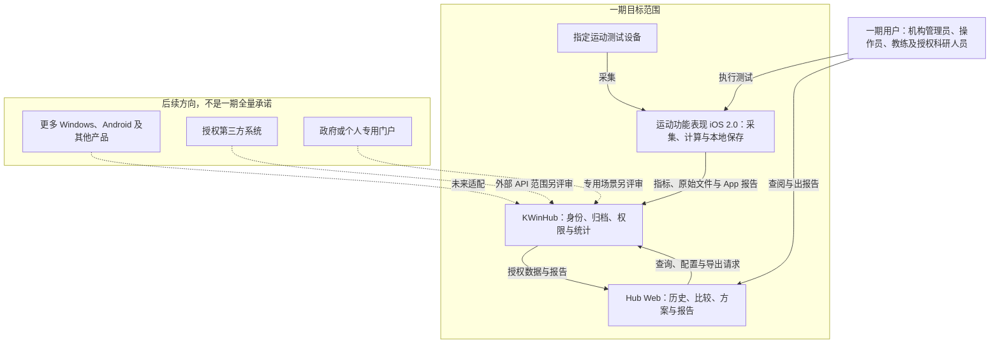

**讲解重点：** 用户买到的是从测试到报告的完整能力；设备通过专用 App 采集，一期不是所有设备直接连云端。Web 是本产品的交付界面，Hub 不只是裸数据库。

**图中未画入的能力：** 云端原始信号科学重算、AI 诊断、完整训练管理、海外生产节点。不画入表示当前不在一期设计闭环中，不代表永远不能建设。

**会议确认：** 首个 App 的正式名称和版本、第一套测试方案、角色范围；视频上传及报告内在线播放已由用户明确纳入当前设计；更多真实产品接入范围仍待确认。

**对应 PRD：** OBJ-01/02/05，FR-06/14，D-01/02/03/10。

## 图 2：系统职责与逻辑架构

**要回答：App、Web、后端和运维的边界在哪里？**

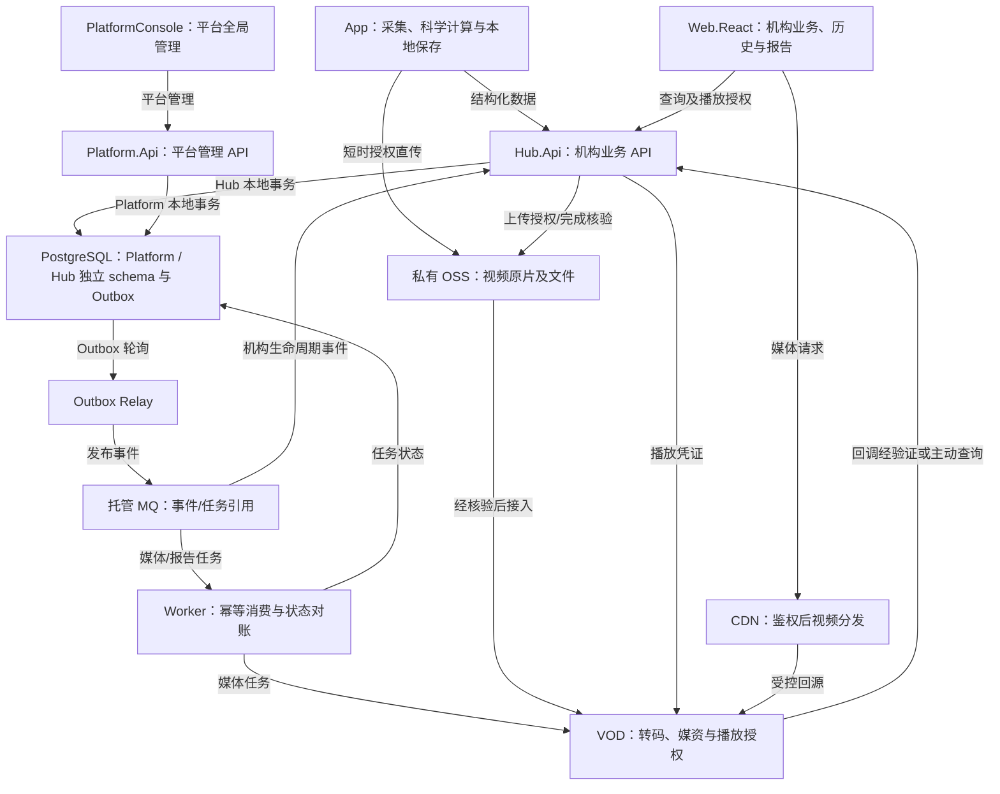

这是逻辑架构与 API 责任图，不是全面微服务部署图。PlatformConsole 只调用 Platform.Api；Web.React 和获准客户端只调用 Hub.Api。两个 API 是独立项目/部署单元，各自内部采用模块化单体与轻量 DDD；Worker/Relay 独立运行，负责媒体、报告及可靠事件投递。两个 API 可以共用基础设施库、身份提供方和 PostgreSQL 集群，但必须有独立 schema、DbContext、迁移、权限策略和发布流水线。Platform 与 Hub 之间通过版本化契约、Outbox/MQ 和幂等消费者集成，不跨边界直接写表，不使用分布式事务。

文件箭头表示逻辑责任，不限定文件必须经过 API 服务器传输。采用签名直传时，由 API 授权、客户端上传到对象存储、服务端确认完整性；下载同样必须受控。

**关键边界：** Platform.Api 管平台级管理；Hub.Api 管机构内业务。App 负责现有科学指标计算；Hub 负责已有指标的统计和报告。查询可用结果不以云端科学 worker 为前提。本轮云平台已确认为阿里云；建议私有 OSS、VOD/CDN、RDS PostgreSQL，MQ 优先评估轻量消息队列 SMQ（原 MNS）。账号认证源、具体地域、实例规格与购买方案仍待定。

| 团队 | 交付责任 | 需要共同确认 |
|---|---|---|
| 产品/业务 | 范围、方案与报告样例、指标含义及验收口径 | 测试场景与待决策项 |
| App | 采集、计算、本地保存、稳定来源 ID、同步与恢复 | payload、单位、版本及离线身份 |
| Platform 后端 | 全局机构生命周期、平台用户/角色、全局目录、平台审计与运行治理 | Platform.Api 契约与 Platform 数据所有权 |
| Hub 后端 | 机构成员授权、人员/测试/指标/资产/媒体/方案报告、租户隔离 | Hub.Api 契约与 Hub 数据所有权 |
| Web 前端 | 授权范围内页面、缺项/失败提示、报告预览及操作 | 页面状态与错误文案 |
| 测试 | 端到端、越权、重试、数值及恢复验证 | 三方验收用例 |
| 运维/数据治理 | 部署、备份、容量、授权/删除政策与运行手册 | 数据驻留、保留与故障处理 |

**会议确认：** 计算边界、唯一一期 Web 入口、认证源、对接负责人及契约交付时间。

**对应 PRD：** OBJ-03/06/08，FR-01/02/06/08/11/12，§8/9/11。双 API 决策详见 ADR-0001。

## 图 3：核心业务与方案报告流程

**要回答：用户怎样从一次测试得到可信报告？**

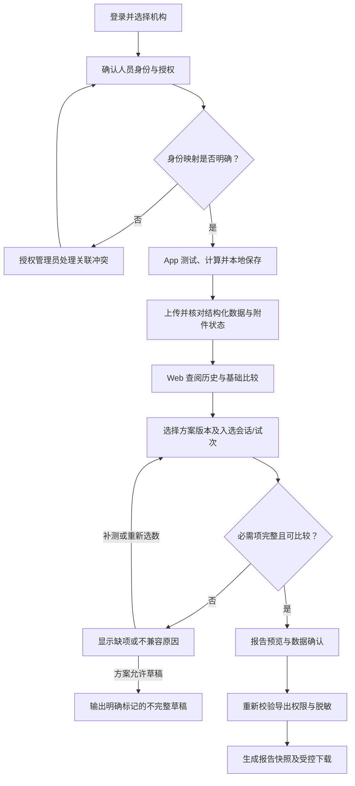

**讲解重点：** 同一人员可以引用多个测试会话；综合报告不是强行把所有数据塞入同一 Session。草稿与完整报告必须区分；缺失不按零处理，也不允许用其他人员或机构记录补齐。

“可比较”至少检查指标定义、方法/版本、单位及已约定取值规则。App 上传的原报告与 Hub 生成的方案报告分别显示来源。新增视频支持嵌入 Hub 在线报告页播放；PDF 导出仅保留视频标识/状态或经批准的访问入口，不承诺 PDF 内嵌视频播放。

此为正常主流程及报告分支，上传错误详见图 5。权限或撤回校验失败时停止相应访问/导出，不绕过限制；人员关联是一项受控确认流程，不是按姓名自动合并。

**会议确认：** 展会方案的指标列表、最佳/平均/选定试次规则、必需附件、缺项报告策略以及导出格式。

**对应 PRD：** FR-03/05/09/10/14，AC-02/07/08/09/10。

## 图 4：核心数据关系

**要回答：机构、人员、测试和报告如何关联，为什么不会混人混库？**

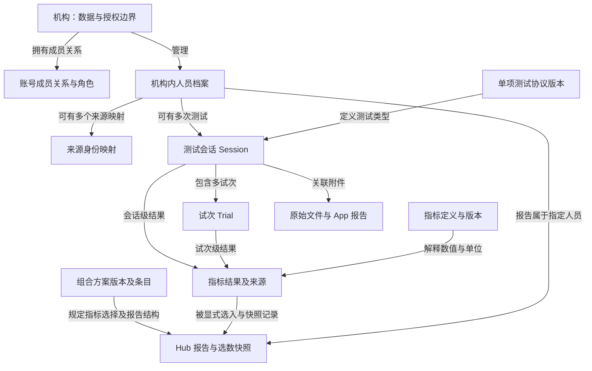

本图是逻辑关系图，不是最终 ERD，不把箭头当作数据库外键或所有权的完整列举。每个业务对象必须有服务端可验证的租户授权路径；报告、文件和方案虽未逐一画出机构连线，也不能脱离机构治理。文件还可关联具体试次。

| 关键区别 | 必须保持的规则 |
|---|---|
| 账号与人员 | 一个运动员档案不要求有登录账号；账号通过机构成员关系获得权限 |
| Hub 人员 ID 与外部 ID | 映射包含机构、来源及必要的安装/数据库作用域，不能只用姓名或手机号 |
| Session 与 Trial | 一次测试事件可以有多次尝试；结果可能在会话级或试次级，不能重复统计 |
| 单项协议与组合方案 | 协议说明怎么测试；方案说明组合哪些测试/指标来出报告 |
| 指标定义与结果 | 定义说明含义、方法和单位；结果保存具体值与来源版本 |
| App 报告与 Hub 报告 | 前者作为来源文件归档；后者记录模板、选数与生成快照 |

设备、来源应用、分组、审计、授权和迁移批次在详细模型中继续展开；为保持会议可读性，本图不展开这些关系。一期可保留多设备关联设计，但不表示已实现所有设备接入。

**会议确认：** 人员映射作用域、关联审批、协议与方案命名、试次选择及版本规则。

**对应 PRD：** FR-03/04/05/06/10，§7，D-13。

## 图 5：同步状态与异常恢复

**要回答：怎样保证断网不丢、重试不重、部分成功不假报完成？**

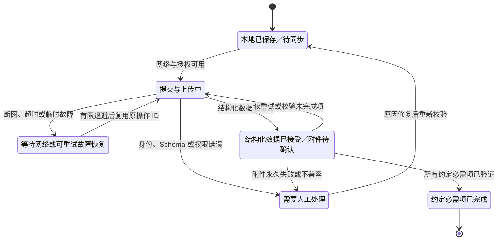

这是面向用户的**汇总状态建议**，不是单一数据库字段。服务端结构化接收状态、每个文件上传/校验状态、客户端队列状态分别保存。一个会话“完成”表示约定必需项完成；视频是当前设计中的支持能力，但不能与会话成功共用一个状态：SessionSyncStatus、VideoUploadStatus、MediaProcessingStatus 分别记录。报告先展示有效指标，并对视频显示“待上传／处理中／可播放／失败”。具体方案可以要求视频作为最终归档条件，但不得阻塞已接收指标的查看。

| 异常 | 行为 | 禁止行为 |
|---|---|---|
| 服务端成功但客户端超时 | 用同幂等键查询/重试，返回既有记录 | 新建另一份会话 |
| 同键提交不同内容 | 冲突提示，按更正契约处理 | 无提示覆盖旧结果 |
| App 退出或崩溃 | 从持久化队列恢复 | 只在内存保存任务 |
| 部分附件失败 | 保留已接受数据，显示缺项，重试失败项 | 清空成功数据或展示全部成功 |
| 人员映射不明 | 阻止误关联并进入受控处理 | 按姓名猜测归属 |
| 无权限或授权过期 | 提示重新认证/申请权限，重新校验 | 无限重试或绕过权限 |
| 文件校验不符 | 不标记可用，记录原因并重新传输 | 未验证即用于正式报告 |

修复无效请求后，是否继续原操作或创建新操作必须遵守冻结的幂等/更正契约；已被服务端接受的内容不得用相同键悄悄替换。上传成功不代表视频可播放，也不代表报告已生成；一期科学指标在 App 中已计算，不新增云端科学计算状态。

**会议确认：** 完成定义、必需附件、错误分类、重试上限、客户端状态和服务端状态映射。

**对应 PRD：** FR-06/07/08，AC-03/04/05/11。

## 图 6：分阶段交付与依赖

**要回答：一期怎么完成，哪些工作必须提前，哪些不能顺带扩大？**

以下日期来自 V1.2 建议计划，不是已批准工期。2027 年 2 月底为会议目标的年份推定，须与资源和展会日期一起确认。条形只表示建议工作窗口，不表示完成进度。

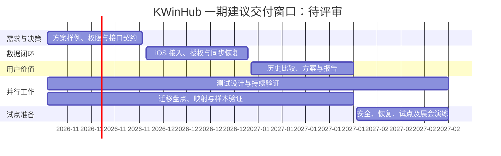

| 关口 | 退出证据 | 不能误解为 |
|---|---|---|
| G0：需求与契约 | 已选真实方案、payload、报告样例；角色矩阵、容量指标、待决策与用例评审 | 只确认 PRD 标题或功能清单 |
| G1：数据闭环 | 真实 iOS 数据可上传读取，重试与隔离通过 | 只有登录页和空架构 |
| G2：方案报告 | 用户可查历史、比较、选数、预览并导出报告 | 只有静态图表或假数据展示 |
| G3：试点演练 | 冻结 P0 通过，恢复与展会流程完成 | 自动完成所有客户迁移或全球上线 |

迁移执行批次、Android/Windows 改造、更多产品接入、海外节点和外部开发者平台必须分别排期。迁移准备提前进行，不代表一期默认承担全部客户全量切换。测试和安全验证贯穿开发，二月不是第一次测试。

**会议确认：** 团队投入、实际迭代日期、客户/展会交付口径、迁移批次与依赖负责人。

**对应 PRD：** FR-13/14，§10/12/13，D-06/07/14。

## 图 7：账号注册、机构开通与成员加入

**要回答：新用户如何获得账号，成为哪个机构的什么角色，何时才有权访问业务数据？**

**建议一期模式：机构由平台受控开通，普通成员通过邀请加入；开放自助注册、创建机构和官网一号通均需另行确认。** 本图是对 FR-01/02 的产品补充建议，不表示立项会已经批准具体注册方式。账号验证、成员加入和数据用途授权是三个不同步骤。

### 7.1 账号取得与登录

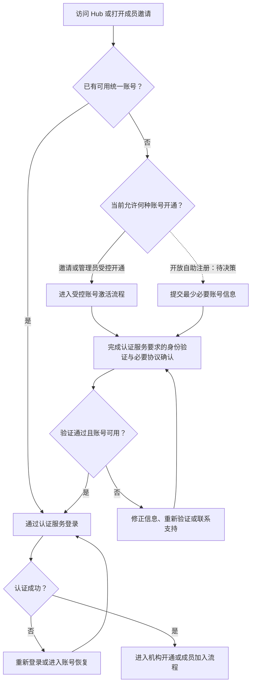

账号认证复用经评审的身份服务；邮箱/手机号、验证码/密码或其他方式以认证源为准。若账号已存在，引导登录或恢复，不重复建立账号；不通过普通错误提示暴露其他用户账号是否存在。官网账号只有完成身份提供方及绑定规则评审后，才能视为 Hub 可用账号。

### 7.2 机构开通、邀请与首次进入

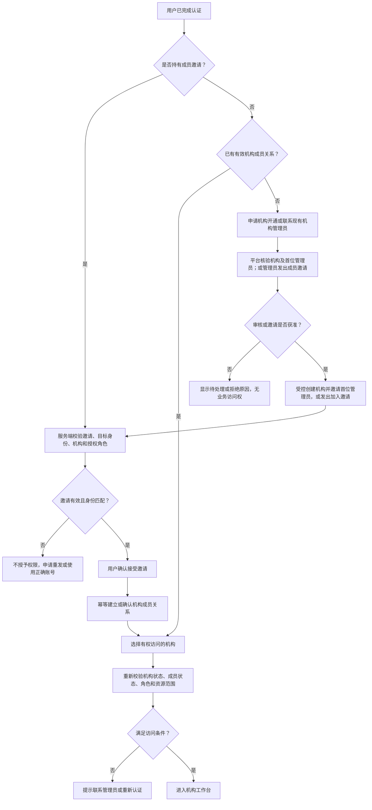

机构申请、核验、创建、首位管理员指定均为服务端受控操作；申请人不能在注册表单中自行选择平台管理员或直接获得机构管理员权限。图中的“审核”是建议的一期受控开通策略，不预设必须自建完整审批系统，可由授权运营人员按流程办理。

### 7.3 关键产品规则与验收

| 环节 | 规则 | 验收场景 |
|---|---|---|
| 账号与成员 | 注册/激活账号不自动创建机构成员关系 | 已登录但无成员关系，只见加入/开通引导，不能查询业务数据 |
| 机构与身份 | 相同单位名称、邮箱域名不自动证明机构归属 | 同名机构申请进入核验，不自动加入既有租户 |
| 邀请安全 | 邀请绑定目标身份、机构和允许角色；有有效期，可撤销；凭证不得进入日志 | 过期、已撤销、机构停用或身份不匹配时拒绝；重复接受不产生重复成员 |
| 首位管理员 | 平台核验指定，邀请激活；高权限不能由普通申请人自选 | 修改请求中的角色/机构 ID 不能提升权限 |
| 已有成员 | 邀请不静默覆盖已有角色；角色变更走独立授权流程 | 已有普通成员不能用重复邀请请求自行提权 |
| 权限变更 | 入组、退出、停用、降权均重新校验并审计 | 机构停用或成员停用后后续业务访问被拒绝 |
| 多机构 | 同一账号可有多个经批准的成员关系，进入时明确当前机构 | 切换机构后列表、详情和文件权限同步变化 |
| 账号与运动员 | 注册不自动生成运动员档案，不按姓名/手机号自动绑定档案 | 操作员有账号但可无运动员档案；已有档案可没有账号 |
| 用途授权 | 服务条款/隐私告知与运动员数据用途授权分别管理 | 成功注册或加入机构，不代表获得全部健康数据、科研用途或导出权限 |
| 审计 | 记录机构开通、邀请发送/撤销/接受、成员及角色变更 | 可追溯操作者、机构、时间与结果，不记录邀请密钥或验证凭证 |

### 7.4 需要在会议上确认

- 账号来源：复用官网身份服务，还是现有 Hub 认证？采用什么验证与恢复方式？
- 开放范围：一期仅邀请制，还是允许自助注册账号？二者不能混同为自助创建机构。
- 开通职责：谁核验机构、谁指定首位管理员、如何处理重复申请及管理员交接？
- 邀请策略：有效期、重发/撤销、可授予角色及现有成员角色变更规则。
- 个人用户：一期是否可独立使用？若可以，需要单独定义个人数据空间，不能默认为机构管理员或自动归入公共租户。

**对应 PRD：** FR-01/02/03/11/12，D-09/10/11/13。本图需与认证、成员接口及权限矩阵共同评审，再回写 PRD；不会自动扩大一期注册门户范围。

## 图 8：测试数据与视频分开上传及异步播放

### 8.1 双上传与标准关联

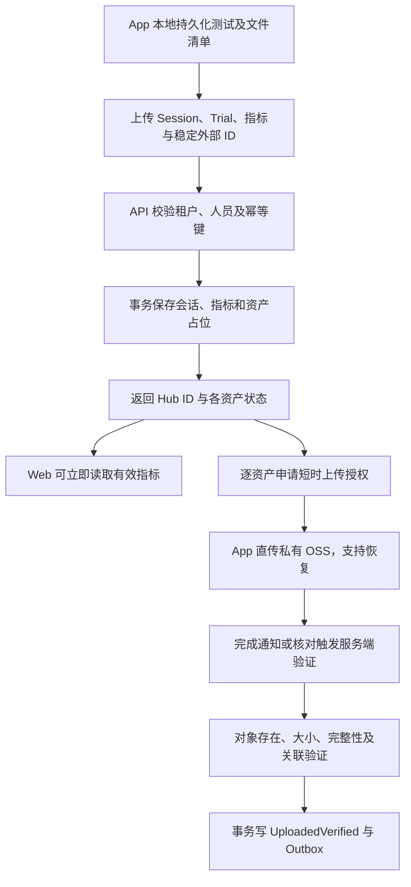

测试指标与视频上传使用不同请求和本地队列。先确认会话 ID 与资产关联，再逐文件上传；开始新会话不要求等待上一个视频完成。每个资产的授权独立，不授予整个机构 Bucket 列举权限。App 不能直接向服务端生产 MQ 发送可信业务事件。

标准关联建议包含 OrganizationId、SubjectId、SessionId、可空 TrialId、AssetId、SourceInstallationId 与外部记录/资产 ID。OrganizationId 来自服务端验证的权限上下文；文件清单保存类型、大小、可用校验值和原始格式，具体字段以真实样本冻结。视频可在会话级或试次级，但必须明确，不能凭文件名猜测绑定。

客户端“上传完成”仅是提示：服务端需要核实目标对象及预期元数据。分片上传不能把 ETag 一律视为整文件 MD5；按选定上传模式采用可靠校验方式。通知重复或丢失不制造重复资产，定期核对可补齐丢失事件。

对象存储访问通过 `IObjectStorage` 抽象隔离，服务端不直接依赖具体云 SDK。该抽象至少覆盖：签发短时上传授权（Presigned URL 或等效机制）、查询对象元信息（大小/ETag/Content-Type/最后修改时间）、获取对象校验值、删除对象以及存在性检查。`IObjectStorage` 的实现由配置驱动，一期落地阿里云 OSS 适配器，海外场景切换为 AWS S3 适配器，业务代码无需改动。详见 8.5 节多云抽象。

### 8.2 Outbox 到 MQ 到媒体处理

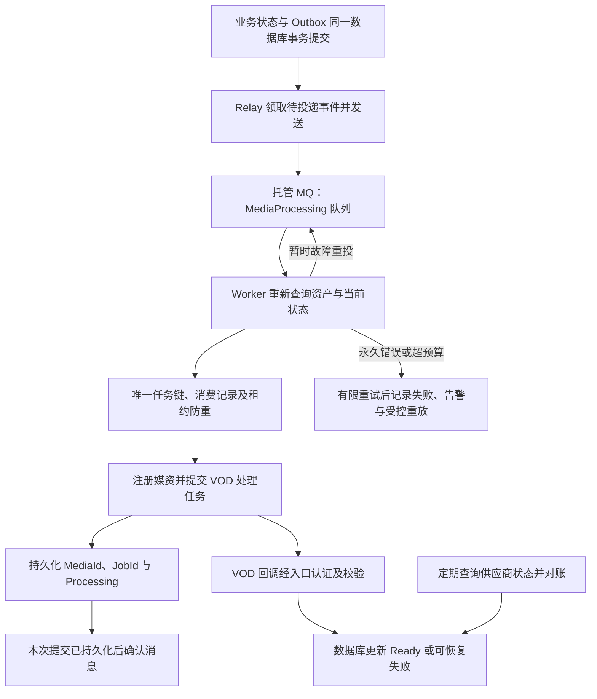

消息不承诺严格按顺序或只投递一次。建议 EventId 全局唯一，ProcessingKey 由 AssetId、资产修订及处理配置版本组成；数据库唯一约束与条件更新作为正确性保障。消息中的租户和对象引用仍必须与数据库归属匹配。

消费确认表示“已可靠接受并记录这项处理工作”，不代表“视频已转码完成”。Worker 提交外部任务后持久化标识即确认；长时间转码由回调及主动查询推进。短任务若超出可见性窗口，续租/延长可见性；进程崩溃后重投由幂等记录处理。

Outbox 已发送但未成功标记的故障会造成重复投递，允许发生。VOD 已创建媒资但本地未记录的模糊结果，必须先查询/对账再重试；不能只靠 MQ 去重保证外部副作用仅一次。回调需要使用供应商支持的校验机制，并验证账号、任务及资产映射；业务更新落库后才应返回成功。过期版本、删除中的资产或乱序回调不能复活旧版本。

Queued 状态超过约定时间时，对照任务表、消费记录和队列指标核对；在保留期到期或消息不可恢复时，允许以同一逻辑任务 ID 重新投递，不能把队列长期保留当成唯一恢复机制。

重试保留原逻辑任务 ID；人工重放必须记录原因，媒体修订或转码配置变化才创建新处理版本。任务过期、重试上限、失败队列与延迟参数在联调时冻结，不在图中虚构默认值。

### 8.3 在线报告与受控播放

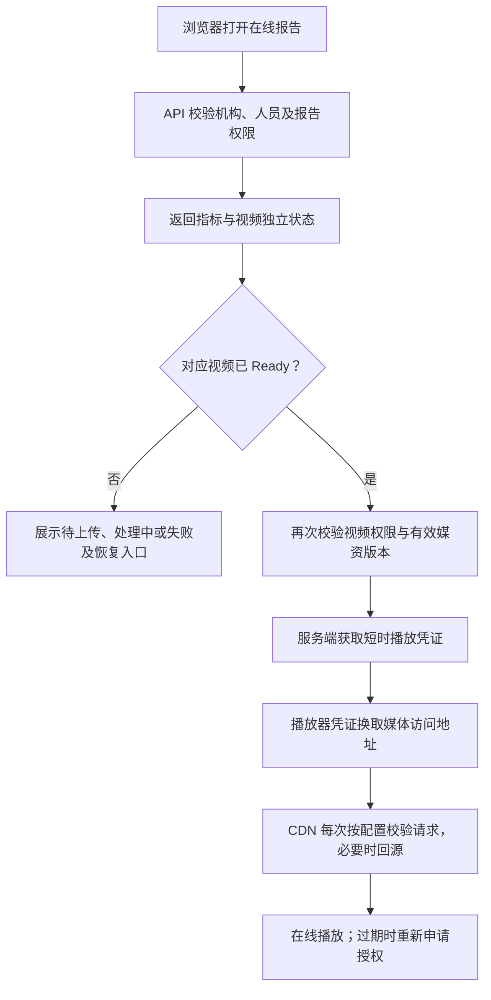

指标展示与视频就绪互不冒充。一个报告可关联多个资产，按资产展示状态；一段视频失败不得把其他有效指标都标为无效。方案要求完整视频时可以限制“完整归档”标志，但仍应允许查看已接受的有效数据。

### 8.4 状态及恢复验收

| 状态维度 | 建议值 | 与其他状态的关系 |
|---|---|---|
| 会话同步 | LocalOnly、Submitting、Accepted、Failed | Accepted 后指标可读，不等待视频 |
| 视频上传 | Pending、Uploading、Verifying、UploadedVerified、Failed | UploadedVerified 才允许发布媒体任务 |
| 媒体处理 | NotRequested、Queued、Processing、Ready、Failed | Ready 才签发该版本的有效播放授权 |
| 报告 | Draft、Generated，以及关联媒体状态 | 报告已生成不代表所有媒体 Ready；状态不混用 |

| 验收场景 | 必须结果 |
|---|---|
| 指标成功、视频未上传 | 指标可查看；视频准确显示待上传 |
| 单视频失败或 App 重启 | 只恢复失败资产，已接收会话不重复 |
| 完成通知重复或丢失 | 唯一资产与事件；核对任务补齐遗漏 |
| MQ 暂时不可用 | Outbox 保留待投递，指标服务不因等待 MQ 而失败 |
| 重复消息或 Worker 崩溃 | 不制造重复有效处理版本，任务可恢复 |
| 外部提交成功但本地超时 | 先查供应商状态再重试，记录模糊结果处理 |
| VOD 回调乱序或漏发 | 旧版本不覆盖新状态，主动查询补齐 |
| 跨机构篡改 AssetId/VideoId | 上传、关联、回调映射和播放授权均不能越权 |
| 权限撤回或资产删除 | 停止新凭证；按有效期和缓存政策处理已有链接，清理原片与派生物 |
| 视频处理积压 | 媒体队列与报告队列隔离，限并发并告警；不得无限重试 |

**对应 PRD：** FR-02/06/07/08/10/12，AC-03/04/05/06/10/11；新增媒体异常用例应进入下一版 PRD 验收矩阵。详尽状态枚举是建议契约，需客户端、后端和测试共同冻结。

### 8.5 多云存储与媒体处理抽象

一期以阿里云为落地云，海外应用上线时切换至 AWS S3。为避免业务代码耦合具体云厂商，对象存储、消息队列与媒体处理均通过应用层接口隔离，适配器实现放在 Infrastructure 层，由配置项决定注入哪一个。

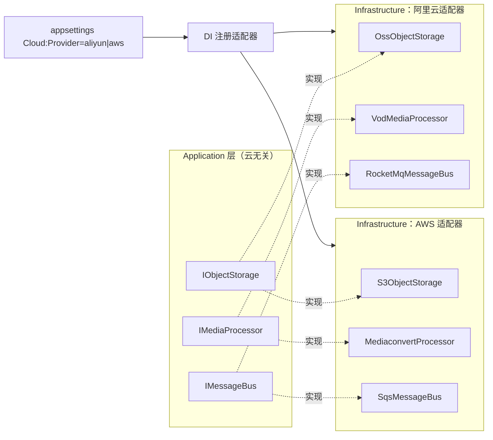

**核心抽象接口：**

| 接口 | 职责 | 阿里云实现 | AWS 实现 |
|---|---|---|---|
| `IObjectStorage` | 签发上传授权、查询对象元信息、校验、删除 | `AliyunOssObjectStorage` | `S3ObjectStorage` |
| `IMediaProcessor` | 注册媒资、提交转码任务、查询处理状态、获取播放凭证 | `AliyunVodProcessor` | `MediaConvertProcessor`（待定） |
| `IMessageBus` | 投递/消费消息、可见性延长、死信 | `RocketMqMessageBus` | `SqsMessageBus` |

**`IObjectStorage` 能力对齐：**

| 能力 | 阿里云 OSS | AWS S3 | 说明 |
|---|---|---|---|
| 短时上传授权 | 预签名 URL（`GeneratePresignedUri`） | 预签名 URL（`GetPreSignedURL`） | 过期时间由配置控制，默认 15 分钟 |
| 对象元信息 | `GetObjectMetadata` | `GetObjectMetadataAsync` | 读取大小、ETag、Content-Type、LastModified |
| 校验值 | ETag 或自定义 Header | ETag | 分片上传时 ETag 不等于 MD5，需额外校验策略 |
| 路径样式 | Path-Style 或 Virtual-Hosted-Style | 支持两种 | MinIO 本地开发使用 Path-Style |
| 区域/Endpoint | Region + Endpoint | Region | 由 `ObjectStorage:ServiceUrl` 等配置项注入 |

**适配器切换机制：**

1. `appsettings.json` 中 `Cloud:Provider` 配置项决定激活的适配器集合（`aliyun` 或 `aws`）。
2. `AddHubInfrastructure` 扩展方法根据该配置注册对应的 `IObjectStorage`、`IMediaProcessor`、`IMessageBus` 实现。
3. 业务层（`AssetService`、媒体 Worker、Outbox Relay）只依赖抽象接口，不引用任何云 SDK。
4. 本地开发使用 MinIO（S3 兼容）作为 `IObjectStorage` 的默认实现，与生产阿里云 OSS 行为一致。

**视频播放凭证的多云处理：**

- 阿里云 VOD：服务端调用 `GetVideoPlayAuth` 获取短时 PlayAuth，播放器 SDK 用 PlayAuth 换取播放地址；CDN 鉴权走 VOD 内置机制。
- AWS 方案：服务端生成 CloudFront 签名 URL 或使用 AWS MediaConvert + S3 预签名 URL；播放凭证有效期与权限校验逻辑在 `IMediaProcessor` 抽象内统一。
- 无论哪种云，播放授权均需二次校验机构/人员/报告/资产权限，凭证短时效（分钟级），资产非 Ready 状态不签发凭证。

**配置项约定：**

```json
"Cloud": {
  "Provider": "aliyun"
},
"ObjectStorage": {
  "ServiceUrl": "https://oss-cn-hangzhou.aliyuncs.com",
  "AccessKey": "",
  "SecretKey": "",
  "Bucket": "kwinhub-assets",
  "Region": "cn-hangzhou",
  "ForcePathStyle": false,
  "UploadGrantExpiryMinutes": 15
}
```

切换到 AWS 时只需将 `Provider` 改为 `aws` 并填入对应 `ServiceUrl`、`Region`、`Bucket` 与凭证；业务代码和数据库结构不变。

## 技术方案依据与选型验证

采用产品边界和队列任务的最小必要复杂度。任务表/Outbox、队列与消费记录各司其职：数据库是业务状态事实源，MQ 是交付通道，OSS/VOD 保存媒体；客户端本地队列负责断网，不能与服务端 Outbox 混同。

| 官方依据 | 对本方案的支持 |
|---|---|
| [阿里云 SMQ 队列](https://www.alibabacloud.com/help/en/mns/developer-reference/queue-queue) | 至少一次投递与可见性超时，消费者需要幂等 |
| [SMQ C# 队列接入](https://www.alibabacloud.com/help/en/mns/developer-reference/manage-queues-by-using-csharp-sdk-based-on-sdk-reference-of-the-new-version) | 接收、删除与可见性延长；目标 .NET 版本需验证 |
| [VOD 媒资注册](https://www.alibabacloud.com/help/en/vod/developer-reference/api-vod-2017-03-21-registermedia) | 支持配置范围内的自有 OSS 媒资注册 |
| [VOD 播放凭证](https://help.aliyun.com/en/vod/user-guide/use-playback-credentials-to-play-videos) | 服务端取凭证、播放器访问 CDN 的授权链路 |
| [Transactional Outbox](https://docs.aws.amazon.com/prescriptive-guidance/latest/cloud-design-patterns/transactional-outbox.html) | 数据更新与待发事件同库提交；消费去重仍必要 |
| [ASP.NET Core 性能实践](https://learn.microsoft.com/aspnet/core/fundamentals/best-practices) | 异步 I/O，避免阻塞与无意义 Task.Run |

选型验证门槛：目标国内地域与网络入口、C#/.NET 客户端兼容、消息重试/失败策略、服务端授权与 VOD 回调验证、自有 OSS 适配、视频格式兼容和容量成本。未核验的配额、SLA、默认参数和价格不作为购买承诺。

## 建议会议议程与决策记录

建议 45–60 分钟：图 1–2 约 15 分钟；图 3–4 约 15 分钟；图 5 约 10 分钟；图 6 和决策约 10–20 分钟。避免在全体会上展开数据库字段和具体组件配置。

| 需形成的结论 | 当前建议 | 负责人 | 结论及日期 |
|---|---|---|---|
| 一期计算边界 | App 计算，Hub 存储/基础统计/报告 | 项目负责人＋软件负责人 | 待填 |
| 首套展会方案 | iOS 已稳定输出的测试与指标 | 产品＋销售＋App | 待填 |
| 视频与第二真实产品接入 | 视频上传及报告内播放已纳入；第二产品另定，视频规格/保留/配额待估算 | 产品＋开发＋运维 | 范围已更新，细节待填 |
| 人员关联与权限 | 机构内受控映射，服务端资源授权 | 产品＋后端＋测试 | 待填 |
| 完成状态与导出格式 | 必需项明确；PDF/CSV/XLSX 逐项确认 | App＋前后端＋测试 | 待填 |
| 时间及迁移安排 | 验证建议工期与客户端依赖 | 项目负责人＋各团队 | 待填 |

图册通过后记录范围版本、评审日期、参与角色和未决事项。PRD 管需求与验收，图册解释边界与流程，接口/数据设计落实技术契约；三者发生冲突时先记录并评审变更，不允许各团队自行选择不同版本。

## 后续逐图深化顺序

1. 产品全景先定，再固定一期范围及用词。
2. 系统职责深化为接口责任表，另做部署图。
3. 业务流程深化为人员、测试、报告三组页面原型。
4. 数据关系深化为经真实 payload 验证的 ERD 与字段字典。
5. 异常流程深化为同步契约、错误码和测试样例。
6. 路线图深化为有负责人、依赖、验收证据的迭代任务。

本图册现有八组图，图 7 含两张注册子图，图 8 含三张上传/处理/播放子图，另附完整技术部署图。未更新 GitHub，也未把评审稿标记为正式基线。