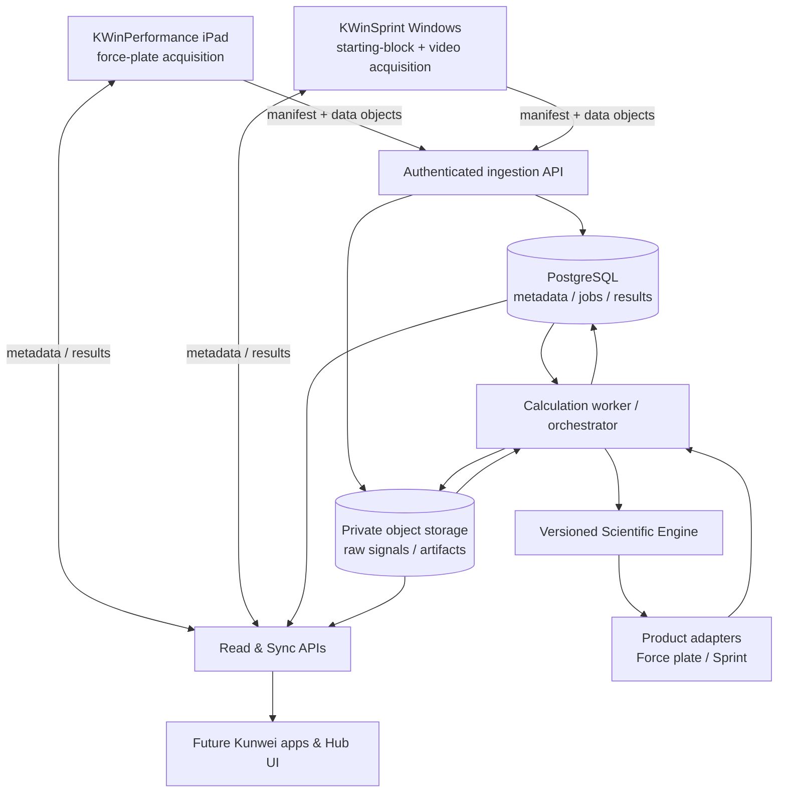
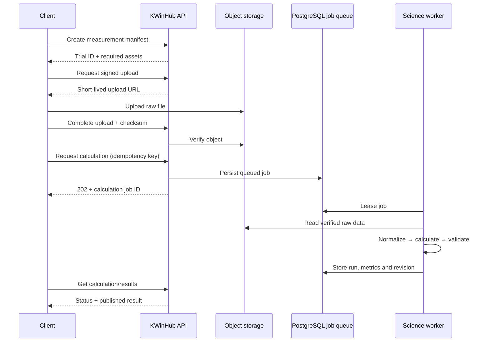

# KWinHub Scientific Calculation Engine — V1 Technical Design (Review Draft)

**Status:** Proposed / Decision pending  
**Date:** 2026-10-27  
**Scope:** KWinHub, KWinPerformance (iPad force plates), KWinSprint (Windows starting blocks)  
**Purpose:** Establish KWinHub as the authoritative, reusable scientific calculation platform for Kunwei products.

> **Evidence and limitations.** This proposal draws on the prior review of the KWinHub.MVP repository and the supplied KWinHub/VALD comparative documents. It is a **target design, not a description of implemented functionality**. Existing KWinHub concepts reported in the prior review include `MeasurementSession`, `Result`, `Metric`, protocols, subjects, PostgreSQL/EF Core, and backend API/application/domain/infrastructure/worker projects. The current main branch was not re-run or retested for this document. Public VALD support material documents scientific analysis in ForceDecks clients and higher-level calculations in VALD Hub; it does not disclose VALD's full internal service implementation.

## 1. Executive decision

**Recommendation: approve a cloud-authoritative, asynchronous scientific computation module within the existing KWinHub modular monolith.**

- Clients **own acquisition**: hardware connectivity, calibration capture, high-frequency streaming, live charting, local storage, and an offline upload outbox.
- KWinHub **owns scientific definitions and authoritative results**: versioned algorithms, event detection, metrics, calculation execution, validation, provenance, historical recalculation, and cross-test analytics.
- Clients **consume published results via versioned APIs**; during disconnection they display `Pending cloud calculation` or, only when required, explicitly marked *provisional local estimates*.
- Retain raw scientific inputs necessary to reproduce a result. Do not force both products into a single native file format; use canonical **ingestion manifests + schema-versioned signal formats** and product-specific adapters.
- Implement as .NET library/module plus independently scalable worker process backed by PostgreSQL and private object storage; avoid microservices and general-purpose workflow engines in V1.

### Non-goals for V1

No normative population engine, no AI interpretation, no arbitrary customer-uploaded algorithm code, no multi-language plugin runtime, no public developer marketplace, no replacement of acquisition software, and no promise of live sub-second cloud biomechanics processing.

## 2. Architectural context and boundaries



**Boundaries:** `Acquisition` (hardware-specific, client); `Scientific Inputs` (validated canonical datasets); `Processing` (algorithm selection, scientific logic, computation); `Publication` (immutable results and active revision pointer); `Analytics` (cross-session derived metrics); `Presentation` (reports, UIs). Application-specific protocol definitions configure shared algorithms; they should not be hard-coded into HTTP controllers.

**Logical modules (names are illustrative):**

- `KWinHub.Science.Contracts` — stable DTO schemas, unit and coordinate conventions, validation errors.
- `KWinHub.Science.Core` — pure numerical and biomechanical algorithms, typed inputs/outputs, deterministic math, no HTTP/EF/dependencies on device SDKs.
- `KWinHub.Science.ForcePlate` — force signals, segmentation, CMJ algorithm implementation.
- `KWinHub.Science.Sprint` — start-block timing, bilateral forces, synchronized sensor events.
- `KWinHub.Application.Calculations` — orchestration, authorization, result publication.
- `KWinHub.Workers` — durable, retryable jobs with bounded concurrency.
- `KWinHub.Infrastructure` — DB persistence, object storage, job leasing, audit.

## 3. Scientific domain model

| Entity | Key fields | Role |
|---|---|---|
| `MeasurementSession` | `Id`, `OrganizationId`, `SubjectId`, `ProtocolVersionId`, `SourceInstallationId`, `ExternalSessionId`, UTC start/end, status | Athlete testing context; preserve existing concept |
| `MeasurementTrial` | `Id`, `SessionId`, `TrialIndex`, `MeasurementType`, UTC start/end | Single analyzable attempt; optional segments/conditions |
| `SessionDevice` | `SessionId`, `DeviceId`, `Role`, `CalibrationRef` | Many instruments per session, critical for KWinSprint |
| `MeasurementDataObject` | `Id`, `OrganizationId`, `TrialId`, `Kind`, `SchemaVersion`, `StorageKey`, `SHA256`, `ByteLength`, `SampleCount`, `SampleRateHz`, `ChannelMap`, `ValidationStatus` | Verified immutable raw inputs and supplemental artifacts |
| `AlgorithmDefinition` | `Code`, `Domain`, `Description`, `Maintainer` | Stable algorithm identity, e.g. `CMJ_FORCE_TIME` |
| `AlgorithmRelease` | `AlgorithmDefinitionId`, `Version`, `BinaryDigest`, `InputSchema`, `ParameterSchema`, `OutputSchema`, `Status`, `EffectiveAt` | Executable, pinned scientific implementation |
| `ProtocolVersion` | `ProtocolCode`, `Version`, `MeasurementRequirements`, `AlgorithmReleaseId`, `DefaultParameters` | Approved test recipe; builds on existing protocol concept |
| `MetricDefinitionVersion` | `Code`, `Version`, `Meaning`, `ValueType`, `CanonicalUnit`, `Method`, `SideOrScope` | Scientific semantics; prevents metric-name collisions |
| `CalculationJob` | `Id`, `OrganizationId`, `TrialId`, `AlgorithmReleaseId`, `InputFingerprint`, `ParameterFingerprint`, `Status`, retry/lease info | Durable execution and idempotency |
| `CalculationRun` | `Id`, `JobId`, `InputManifestDigest`, `AlgorithmReleaseId`, `ContainerDigest`, `StartedAt`, `CompletedAt`, `QualityFlags`, `ErrorCode` | Auditable execution record, including failures |
| `ScientificResultSet` | `Id`, `TrialId`, `RunId`, `Revision`, `Status`, `PublishedAt`, `SupersedesId` | Immutable calculated result revision |
| `ResultMetricValue` | `ResultSetId`, `MetricDefinitionVersionId`, typed value, `Unit`, `Side`, `SegmentId`, `QualityFlags` | Typed metrics and scope; not just `double` |
| `CalculationEvent` | `ResultSetId`, `EventCode`, `OffsetFromTrialStartUs`, `DetectionMethod`, `Confidence` | Detected time points, provenance and audit |

### Scientific data rules

1. **Separate measured input from derived output.** Store raw samples as content-addressable or immutable objects; results reference their exact input digest(s).
2. **Do not conflate sessions, trials, segments, and metrics.** A session may contain many trials, each may have multiple channels/devices and scientific events.
3. **All relevant time bases must be explicit.** Record `UTC trial anchor`, monotonic sample indices, nominal vs observed sample rate, per-device offset, drift estimates, interpolation method, and synchronization confidence where applicable.
4. **Define coordinate conventions.** Document axes, sign, force units (N), time (s or µs), body mass (kg), left/right mapping, calibration and baseline methods.
5. **Version everything that changes interpretation.** Algorithm, metric definition, protocol, normalization settings, manual event corrections, athlete mass source, and relevant calibration revisions.
6. **Never mutate historical scientific outputs in place.** Publish a new result revision and retain lineage; show the active/default revision as a selection, not by deletion.
7. **Protect tenant data end-to-end.** Every job, object, query and result must verify the same authorized `OrganizationId` context.

### Suggested statuses

- `Measurement`: `Created → Uploading → InputsVerified → ReadyForCalculation → Calculating → Calculated → Published`; separate terminal `Rejected` and recoverable `UploadFailed`.
- `CalculationJob`: `Queued → Leased → Running → Succeeded/Failed/Cancelled`; retryable failures return to `Queued` with a bounded attempt counter.
- `ScientificResultSet`: `Draft/Validated/Published/Superseded` (superseded remains queryable).
- Asset upload status is independent from computation status. A failed optional video upload must not block force-signal science unless the selected algorithm requires that video.

## 4. Calculation pipeline

**0. Register:** An authenticated tenant member/client creates a session/trial manifest, passing stable external IDs, protocol code/version, subject mapping and device identifiers. The server resolves ownership and authorizes the subject against the tenant.

**1. Upload:** API issues scoped, short-lived signed object uploads; the client transmits raw inputs directly to private object storage and reports completion with SHA-256 and byte length. Large signals are not embedded in JSON.

**2. Verify and normalize:** Server verifies checksums, MIME/schema, required channels, signal continuity, units, sampling rate, timestamp quality, channel calibration, and physical plausibility. Errors are machine readable, not silently repaired. Adapters produce the normalized input manifest.

**3. Resolve protocol:** Server selects an immutable `ProtocolVersion` and `AlgorithmRelease`, validates parameter compatibility, and constructs a canonical deterministic input fingerprint over **verified object digests + parameter/configuration versions + algorithm release + interpretation-relevant metadata**.

**4. Queue:** Create or reuse an idempotent job. PostgreSQL uniquely enforces the idempotency key/fingerprint as appropriate. Respond `202 Accepted` without doing long computations synchronously.

**5. Execute:** A worker claims the job with a lease, loads verified inputs, invokes the scientific engine, validates finite outputs, plausible ranges and event ordering, and writes artifacts/results atomically where feasible (object staging then DB publish).

**6. Publish:** An approved result revision becomes active; trial/session read APIs expose calculated metrics and structured events. Failures include stable error codes and safe diagnostic context.

**7. Recalculate:** Authorized operator requests calculation with a new release or parameters. The existing result persists; a new run and result revision are created, compared, and explicitly promoted under release rules.



## 5. Proposed REST API (draft, not existing implementation)

Prefix `/api/v1`; existing endpoint names in the repository must be reconciled during implementation to avoid duplicating a session concept.

| Method | Path | Behavior |
|---|---|---|
| `POST` | `/measurement-sessions` | Create session and canonical IDs; idempotent source mapping |
| `POST` | `/measurement-sessions/{id}/trials` | Create one trial with declared input manifest |
| `POST` | `/data-objects/uploads` | Validate asset authorization and issue signed upload |
| `POST` | `/data-objects/{id}/complete` | Check digest, size and schema; transition to verified |
| `POST` | `/trials/{id}/calculations` | Pin a protocol/algorithm release, queue job; return 202 |
| `GET` | `/calculations/{jobId}` | Job status, quality flags, error code, result ID |
| `GET` | `/trials/{id}/results` | Result revisions and active published revision |
| `GET` | `/result-sets/{id}` | Typed metrics, event markers, provenance, artifact links |
| `POST` | `/trials/{id}/recalculations` | Authorized new revision with reason; no overwrite |
| `POST` | `/result-sets/{id}/promote` | Privileged approve/select default published revision |
| `GET` | `/scientific/protocols` | Supported versions and input requirements |
| `GET` | `/scientific/metrics` | Versioned dictionary with units and semantics |
| `GET` | `/sync/changes?cursor=...` | Tenant-filtered metadata/results incremental sync |

### Example calculation request

```json
{
  "schemaVersion": "1.0",
  "protocolCode": "CMJ",
  "protocolVersion": "1.0.0",
  "algorithmCode": "CMJ_FORCE_TIME",
  "algorithmVersion": "1.0.0",
  "parameters": {
    "bodyMassKg": 78.4,
    "bodyMassSource": "measured-at-test",
    "gravityMps2": 9.80665,
    "eventDetectionPreset": "standard-v1"
  },
  "reason": "initial-processing"
}
```

`Idempotency-Key` HTTP header required for writes that can be repeated by sync retries. `organizationId` must come from authenticated server-side scope, not be trusted from the request body. Algorithm versions above are illustrative, not existing releases.

### Example completed result

```json
{
  "resultSetId": "<uuid>",
  "trialId": "<uuid>",
  "revision": 1,
  "status": "Published",
  "provenance": {
    "algorithmCode": "CMJ_FORCE_TIME",
    "algorithmVersion": "1.0.0",
    "inputManifestSha256": "<sha256>",
    "parametersSha256": "<sha256>",
    "processedAtUtc": "2026-10-27T06:00:00Z"
  },
  "metrics": [
    {
      "metricCode": "CMJ_JUMP_HEIGHT_FLIGHT_TIME",
      "definitionVersion": "1.0",
      "valueType": "number",
      "value": 0.315,
      "unit": "m",
      "side": null,
      "qualityFlags": []
    }
  ],
  "events": [
    {"code": "TAKEOFF", "offsetFromTrialStartUs": 1250000},
    {"code": "LANDING", "offsetFromTrialStartUs": 1757000}
  ]
}
```

Example values are fictional and not a validated biomechanical test. Ensure metrics distinguish different jump-height estimation methods; do not label all as simply `JUMP_HEIGHT`.

## 6. Scientific engine contract and calculation policy

```csharp
public interface IScientificCalculator<in TInput, TResult>
{
    string AlgorithmCode { get; }
    string AlgorithmVersion { get; }
    TResult Calculate(TInput input, ScientificCalculationContext context);
}

public sealed record ScientificCalculationContext(
    string ProtocolCode,
    string ProtocolVersion,
    IReadOnlyDictionary<string, string> Parameters,
    string InputManifestSha256);
```

This is a *concept*, not compile-ready production code: model strongly typed physical quantities, validated parameters, cancellation, telemetry and explicit typed errors during implementation. The scientific function should have no database calls, HTTP calls, tenant queries, mutable global state, or implicit current time. Its outputs should not depend on machine locale. Preserve floating-point tolerance and environment/compiler version where bit-identical results cannot be guaranteed.

**Input preparation:** Product adapter `ForcePlateNormalizedInput` carries ordered samples, calibrated force components, channel/device roles, body-mass and synchronization metadata. Sprint adapter handles front/rear forces, movement onset, optional camera timing, and coordinate mapping without forcing sprint signals into a vertical-jump schema.

**Output structure:** Calculators return metrics + events + segments + algorithm warnings + optional derived traces. Presentation layers format units and charts, but must not silently re-implement scientifically meaningful formulas.

**Metric registry:** Every metric includes code, dimension, canonical unit, definition/method, precision guidance, side/scope, derived-from relations and deprecated/replacement rules. UI localization and human-readable labels are separate.

**Algorithm release governance:** `Draft → Validated → Approved → Deprecated/Retired`, with reference fixture checks and an approval record. Roll out by protocol/version rather than rewriting old results. For a newly approved release, define whether new tests use it automatically and whether historical data requires operator opt-in to reprocessing.

## 7. Offline first and real-time requirements

- Clients remain fully capable of **acquiring and safely storing measurements without connectivity**.
- Cloud calculation starts only after required inputs are verified; UI can show `Awaiting upload`, `Queued`, `Processing`, `Published`, or `Needs attention`.
- Standard scientific reports should not appear as authoritative until cloud publication.
- If field testing requires immediate numerical feedback, assess **shared-library execution at the edge** as a later feature; clearly label results `Provisional` and attach identical algorithm/configuration digests. Do not maintain separately coded iPad/Windows formulas indefinitely.
- Safety/operational thresholds or live stopping conditions cannot depend on cloud round trips. Any device-control logic remains local.
- Upload outbox uses durable local IDs, exponential backoff, resumable transfer for large objects and per-object sync state. Duplicate submissions must not create duplicate sessions or runs.

## 8. Security, privacy and tenancy

- Authentication for native clients: user-bound OAuth/OIDC Authorization Code + PKCE; refresh token policies and logout/revocation as appropriate. Avoid embedding service secrets in apps.
- Verify membership and role for every session, trial, data object, processing job and result; never trust `OrganizationId` in a payload.
- Signed object upload/download tokens must be short-lived and restricted to object, operation, type and maximum size.
- Private buckets, encryption at rest/transit, checksums, malware/content validation appropriate to file types, least-privilege worker service accounts, audit trail.
- Athletes/subjects: consent and retention policy, right to deletion/export where applicable, clear separation of raw biometric/measurement data and account authentication data.
- Restrict expensive reprocessing operations with quotas and role gates; resist job abuse, oversized payloads and decompression bombs.
- `InputFingerprint` and object IDs are authorization-scoped. Cross-tenant cache reuse must not reveal data existence or content.

## 9. Storage, operations and reliability

**PostgreSQL:** identities, manifests, job state, result metadata, metrics, events, audit. **Private S3-compatible object storage:** raw CSV/binary, derived traces, videos, large calculation artifacts. Preserve immutable raw objects. Retention requires policy and lifecycle management.

**Queue MVP:** PostgreSQL-backed job table with atomic claim / lease / heartbeats; no Redis or message broker requirement initially. A dedicated worker process can scale independently without turning the logical calculation module into a microservice. Retry transient infrastructure errors, do not automatically retry deterministic scientific input errors.

**Observability:** correlation ID across client upload → object → job → run → result; structured logs excluding raw personal data; metrics for queue wait, processing duration, failure rate, checksum mismatch, upload completion, result parity; dead-letter/failed-job review and support diagnostics.

**Idempotency:** distinguish `SourceInstallationId + ExternalSessionId` for session identity from `TrialId + input digest + algorithm release + parameter digest` for calculation equivalence. Changes to manual events, participant mass or calibration must yield a new fingerprint.

**Consistency:** upload completion alone never implies eligible-for-calculation; calculation success alone never implies published result. Commit verified input state before enqueue; stage artifacts and commit DB result/revision atomically; repair orphaned staged objects with cleanup jobs.

## 10. Migration and integration plan

### Workstream A — KWinPerformance

1. Inventory existing iPad SQLite concepts (`records`, `record_fp`, `segments`, `record_indicators`, `assets`, `sync_state`) and document exact mappings to sessions, trials, waveforms, events and metric values.
2. Capture stable source installation/test IDs, sensor channel map, rate, unit, timebase and calibration metadata at acquisition time.
3. Add reliable raw-force data export/upload; retain local SQLite acquisition records and retry outbox.
4. Implement a **single selected CMJ calculation** in KWinHub with reference recordings; compare every metric/event with the validated existing client output and investigate differences instead of accepting approximate parity by default.
5. Switch the selected test’s authoritative display/report source to KWinHub results. Preserve legacy local outputs for shadow comparison until the acceptance gate passes.

### Workstream B — KWinSprint

1. Map Firebird/MySQL `records` (including existing `recode_id` schema spelling), `record_indicators`, `indicator_definitions`, `record_videos`, `event_markers`, and project/group/athlete references.
2. Extend existing `CloudDataService` concept with measurement manifest, signed raw-data uploads, calculation request and status/results retrieval. Avoid sending locally stored login credentials.
3. Preserve raw force-time data and metadata from front/rear starting blocks, synchronization to video, camera serial/time offset, and local derived event markers.
4. Implement one **sprint-start metric group** as a reference case; validate per-foot and total force/impulse/timing against current desktop results.
5. Move authoritative result generation to Hub *after* parity verification; local desktop records remain an offline cache and acquisition archive.

### Phased delivery gates (scope, not promised dates)

| Gate | Deliverable | Exit criteria |
|---|---|---|
| G0 — Scientific inventory | Metric/algorithm catalog, formulas, input requirements, sample recordings | Two approved reference protocols, owners, documented tolerances |
| G1 — Contracts & security | Input manifest v1, metric dictionary, tenant-scoped APIs, object storage | Unauthorized cross-tenant reads/uploads rejected; idempotent IDs verified |
| G2 — ForcePlate vertical slice | KWinPerformance raw upload → CMJ worker → Hub result → app UI | Offline retry, checksum, parity fixture, recoverable failures pass |
| G3 — Sprint vertical slice | KWinSprint multi-device upload → sprint worker → results | Front/rear identity, timing alignment, parity fixture pass |
| G4 — Recalculation & readiness | Version promotion, result revisions, monitoring, runbook | Old results immutable; authorized reprocess produces auditable new revision |

## 11. Acceptance criteria (proposed)

1. **Scientific parity:** every required reference metric agrees with validated legacy calculator within **metric-specific predefined** tolerances; event timing within a sample-resolution and interpolation-aware bound set by scientific owners (not an arbitrary global percentage).
2. **Reproducibility:** rerunning a pinned algorithm with identical verified input/config produces equivalent results within declared tolerances and identical event ordering/semantics.
3. **Tenant isolation:** a client cannot resolve, upload to, calculate for, read or promote a different tenant's data.
4. **Offline recovery:** an interrupted field test/upload retries without duplicate sessions, trials, raw objects or authoritative result revisions.
5. **Input integrity:** mismatched SHA-256, unsupported channels/units or missing required objects cannot generate published results.
6. **Revision history:** recalculation preserves original results and exposes who/what/why changed, with algorithm and data fingerprints.
7. **Multi-device consistency:** sprint front/rear channels retain identity, calibration and synchronized timebases.
8. **Client independence:** a third application can discover protocol requirements, submit a valid measurement and read structured results without embedding scientific formulas.
9. **Operational resilience:** stuck leases recover, retries have bounded attempts, and failed jobs produce actionable diagnostics.
10. **API compatibility:** clients with supported previous schema versions are handled by explicit compatibility policy, not silent reinterpretation.

## 12. Key risks and mitigations

| Risk | Impact | Mitigation |
|---|---|---|
| Raw data volume/cost | Slow uploads, storage growth | Binary/chunked formats after V1, compression, lifecycle policies, object dedup within tenant |
| Cloud latency in field | Slow result availability | Async jobs, UI statuses, provisional local estimates only if validated business need |
| Legacy scientific inconsistency | Wrong or changed results | Golden reference datasets, explicit method/version definitions, shadow-run comparison |
| Missing calibration/time metadata | Unreproducible output | Required acquisition contracts; reject incomplete scientific inputs |
| Algorithm release regressions | Historical comparability issues | Approval workflow, immutable results, explicit reprocessing/promotion |
| Too-general engine design | Delivery delay | Start with one CMJ and one sprint calculation; extract abstractions from both |
| Tenant leakage via object access | High-severity security incident | Tenant-scoped authorization and signed URLs; security integration tests |
| Scientific liability from ambiguous metrics | Misinterpretation | Method-specific metric codes, quality flags, original units and limitations |

## 13. Decisions requested from Kunwei

| Decision | Proposed default | Alternative / reason to review |
|---|---|---|
| D1 — Execution authority | Hub/cloud final, offline clients acquire and queue | Shared local engine if instant offline numeric feedback is product-critical |
| D2 — Initial protocols | One CMJ variant + one Sprint Start metric group | Another protocol if fixtures/source code are more mature |
| D3 — Calculation scheduling | Asynchronous jobs and polling initially | Notifications/websocket later if UX demands |
| D4 — Scientific revision policy | Immutable versions, explicit promotion | Auto-promote only after governance policy is established |
| D5 — Required raw retention | Retain calculation-relevant inputs and provenance | Business-controlled retention tiers, subject to regulatory requirements |
| D6 — Algorithm language/runtime | .NET pure libraries and workers | Additional compute runtime only where algorithm libraries justify it |
| D7 — Multi-tenancy | Strict tenant scope in all data/jobs/objects | No cross-tenant data sharing without separate explicit consent/product design |
| D8 — API compatibility | Versioned schemas and deprecation window | Exact lifecycle and minimum client version to define |

## 14. Implementation backlog (initial)

**P0:** scientific algorithm inventory; reference signal fixtures; ontology/units; tenant security tests; session/trial/input DB migration; signed upload; checksum validation; job persistence/worker lease; one CMJ algorithm + deterministic result persistence; read API; offline outbox integration.

**P1:** KWinSprint adapter; synchronized multi-device model; complete algorithm registry/release approvals; immutable recalculation and promotion; metric dictionary API; per-result provenance UI; operational dashboards.

**P2:** shared edge execution for selected offline use cases; DSI and cross-protocol analytics; normative reference datasets, richer report builder; public integration SDK.

### Repository touchpoints to validate before implementation

The earlier review identified `src/backend/KWinHub.Domain/Sessions/MeasurementSession.cs`, `src/backend/KWinHub.Domain/Results/Metric.cs`, `src/backend/KWinHub.Api/Program.cs`, and subject/auth endpoints. Before authoring migrations, re-inspect current entity mappings, protocol/result services, worker bootstrap and OpenAPI conventions and reconcile names with existing `docs/architecture`, `docs/data` and `docs/api` specifications. This proposal deliberately avoids asserting that unverified endpoints or services already exist.

## 15. Open scientific questions

1. Which exact CMJ protocol/method (flight-time, impulse–momentum, takeoff velocity, etc.) is the approved V1 reference, and are original waveforms available?
2. What measured inputs, sample rates, coordinate conventions and event definitions does the current KWinSprint calculation pipeline actually require?
3. Which analyses must yield actionable on-device results with no connection? What response-time limit is truly needed?
4. Do users need manual adjustment of onset/takeoff/events and scientifically traceable recalculation?
5. What source-of-truth rule applies when legacy results disagree with the new cloud calculator?
6. Who is the scientific approver of algorithm releases and numerical tolerance thresholds?
7. What are the permitted raw-signal/video retention durations and regional data residency requirements?

---

**Review outcome requested:** approve/modify D1–D8, appoint scientific owners for G0, select two reference tests, then turn this into repo-aligned schema migrations, OpenAPI and implementation tickets. No repository code or production data has been changed by this document.
