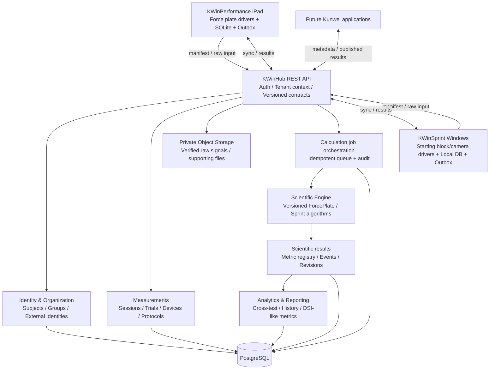
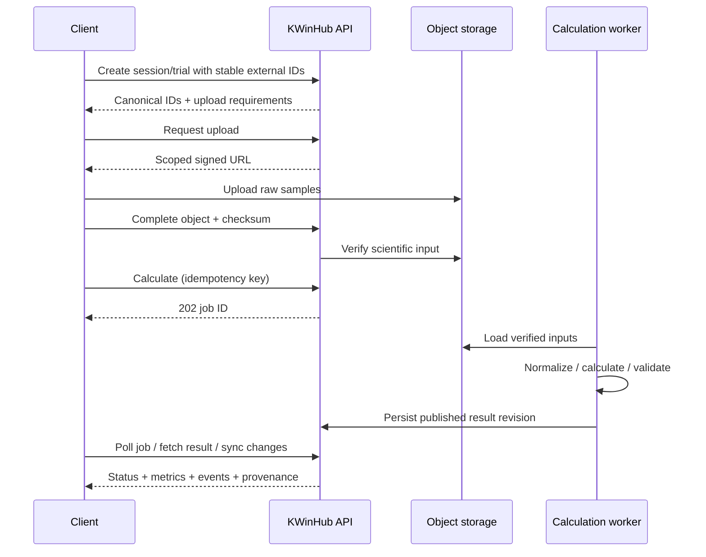

# KWinHub Integration Architecture Review & Development Roadmap — V2

**Status:** Proposed for technical/product review — not approved  
**Date:** 2026-10-27  
**Scope:** KWinHub.MVP, KWinPerformance (iPad / force plates), KWinSprint (Windows / starting blocks), future Kunwei clients  
**Central change since V1:** KWinHub is not simply a SaaS data and reporting hub. It is the **cloud-authoritative scientific computation and unified athlete-data platform**; client software focuses on device acquisition, offline reliability, low-latency visualization, and application UX.

> **Evidence standard.** This update is grounded in the prior repository/document review, the supplied `KWinHub Scientific Calculation Engine — V1 Technical Design`, and the preceding discussion of VALD support material. Specific source-code status is **not freshly verified against GitHub main** in this revision; do not treat proposed endpoints or classes as existing implementations. The older `Explain KWinHub APIs.txt` snapshot records earlier auth/tenant issues, but later repository review identified JWT authentication and tenant-scoped subjects-controller patterns; therefore the current status must be confirmed via code and integration tests rather than inferred from the older report. The competitor's internal infrastructure is not public: VALD observations below concern documented product behavior, not proven internal system design.

## 1. Executive summary and decision

**Recommend proceeding with a modular-monolith KWinHub platform and a dedicated scientific calculation module/worker.** Protect client offline operation, ingest raw measurements with stable identity and provenance, calculate authoritative result sets centrally, expose standardized APIs, and enable algorithm reuse and governed historical recalculation.

**Product outcome:** a third Kunwei application should be able to authenticate, resolve an athlete, discover a measurement protocol, upload compatible raw data, request calculation, and render a standardized result **without re-implementing the scientific algorithm**. Hardware drivers and compatible input adapters are still required.

### Boundary of responsibilities

| Concern | Authoritative owner | Client responsibility | KWinHub responsibility |
|---|---|---|---|
| Device connection / acquisition | Client | Connect, calibrate, sample, detect hardware fault, persist raw data | Define required input contract and provenance |
| Live feedback / device-control safety | Client | Live force plot, immediate safe operational decisions | Not a real-time control dependency |
| Athlete, organization, membership | Hub | Cached profiles; offline selection/create with reconciliation | Authoritative IDs, tenant access, controlled merges |
| Scientific algorithms and official metrics | **Hub** | Upload inputs; show processing state; optionally provisional offline estimates later | Execute versioned algorithms; validate and publish authoritative metrics/events |
| Raw scientific evidence | Hub archive + client acquisition archive | Durable local copy and upload outbox | Verified private object storage, retention, integrity |
| Sessions, trials, results, history | Hub | Offline local IDs/cache and app UX | Canonical session/trial associations, immutable results, sync feeds |
| Reports, comparison, cross-test indicators | Hub scientific/analytics services | Product-specific presentation | Standard metric definitions, report data, DSI-like derived calculations |

**Non-goals for first vertical slice:** redesign of all device clients; full replacement of all historical algorithms; real-time cloud streaming feedback; norms/AI interpretation; public third-party marketplace; complex microservices.

## 2. How the analysis has evolved

| Previous assumption | Updated design | Why |
|---|---|---|
| Clients calculate and Hub stores | Hub calculates official metrics from validated scientific inputs | One managed algorithm implementation; easier cross-client reuse |
| Raw uploads optional | Raw inputs plus metadata are essential for supported protocols | Enables reprocessing and audit, avoids trusting stale client results |
| Unified session/metric API is sufficient | Need ingestion + object verification + calculation jobs + result revisions | Scientific calculation is a durable workflow, not a single CRUD operation |
| Client results are canonical | Legacy results are comparison baselines during migration, then non-authoritative | Prevents inconsistent metrics after migration |
| VALD should be copied | VALD is a capability benchmark, not a confirmed internal blueprint | Public documentation indicates client-side ForceDecks analysis and Hub-side analytics, but not proprietary implementation |
| Single source of truth means no local DB | Keep SQLite/Firebird local persistence as operational cache and offline acquisition archive | Network independence is essential for physical testing |

## 3. Target architecture

**Implementation approach:** ASP.NET Core + existing domain/application/infrastructure separation, PostgreSQL/EF Core, private object storage, durable PostgreSQL job leasing initially, separate worker executable when processing load requires it. The numerical science libraries must not depend on HTTP, EF Core, tenant context, or device SDKs. Prefer typed scientific inputs over one generic dictionary of numbers. A dedicated service boundary can be extracted later if warranted by scaling or deployment differences.

## 4. Cross-client domain model and mapping

| Canonical concept | KWinPerformance source concept | KWinSprint source concept | Notes |
|---|---|---|---|
| Organization / Membership | Local users/context where present | `user`, `coaches` and local roles | Hub is authoritative for SaaS identity; **never upload local encrypted passwords** |
| Subject (athlete) | `athlete` | `athlete`, `guest` | External IDs mapped explicitly; do not silently merge similarly named athletes |
| Group / project association | Local athlete grouping, if applicable | `project`, `project_member`, `group`, `group_member` | Project hierarchy is not automatically an organization/tenant |
| MeasurementSession | `records` (start-to-stop session) | `records` (`recode_id` PK spelling) | Preserve original external IDs and session timestamp |
| Trial / segment | `record_fp`, `segments`, `signs` as applicable | Sprint test/record subdivision; `event_markers` | Exact cardinality must be validated using representative actual records |
| SessionDevice / channel | Force plate IDs and channel metadata | Front/rear blocks, cameras, serials | Many devices per session; calibration and role per device |
| Raw DataObject | `assets` / raw samples, if retained | Raw CSV, `record_videos` | Input schemas, hashes, calibration, sample rate and clocks required |
| MetricDefinition / MetricValue | `record_indicators` | `indicator_definitions`, `record_indicators` | Semantic method + unit + version; source strings normalized at boundary |
| Scientific result revision | Existing local derived outputs | Existing local calculator outputs | Reference comparison, not authoritative after switchover |
| Offline sync state | `sync_state` | Existing `CloudDataService` sync patterns | Durable outbox and server cursor, not only `LastModified` |

**Key modeling choices:** Keep `MeasurementSession`, `Trial`, `Segment`, `Event`, `SessionDevice`, `DataObject`, `CalculationJob`, `CalculationRun`, and `ScientificResultSet` distinct. Extend existing Hub session/metric entities instead of creating parallel concepts. A trial can reference multiple synchronized devices. An event is timestamped against an explicit trial clock; record UTC anchor, sample-index clock, device offset/drift and interpolation assumptions. Store the algorithm release, metric definition version, input digest, body-mass/calibration source, protocol version, processing provenance and quality flags.

## 5. Scientific computation and version governance

### 5.1 Calculation pipeline

1. **Acquire offline safely:** Client writes immutable enough original sensor samples and metadata to local durable storage; record stable installation and test IDs.
2. **Resolve identity and register:** Authenticated client associates subject, protocol and session/trial; server checks organization membership and subject ownership.
3. **Transfer data:** Issue scope-limited signed upload; upload raw waveform and required manifests to private object storage. Video remains independent unless an algorithm explicitly requires it.
4. **Verify and normalize:** Validate SHA-256, file length, schemas, units, channel identity, sample continuity, timebase, calibration and protocol-specific required fields. Reject invalid scientific evidence with machine-readable errors.
5. **Select pinned release:** Resolve approved algorithm and parameters from protocol version; compute fingerprint from inputs, versioned metadata, parameters and release.
6. **Queue and execute:** Persist idempotent job; worker loads verified inputs, invokes science library, validates outputs and event order.
7. **Publish:** Persist metrics/events/artifacts as an immutable result revision; clients retrieve via API and metadata change cursor.
8. **Recalculate intentionally:** New algorithm or corrected scientific metadata produces a new run/revision, retaining the prior published result. Promotion/rollback is controlled and audited.

### 5.2 Algorithm and metric rules

- Algorithm releases move through `Draft → Validated → Approved → Deprecated` (retirement policy to define). Pin semantic version and executable/binary digest.
- Metric codes are method-specific: e.g., distinguish **jump height by flight time** vs **jump height by impulse/momentum**; do not merge merely because display labels match.
- Canonical units and dimensional analysis are defined centrally; conversions for display must not change scientific interpretation.
- Golden fixtures from current CMJ and sprint calculators establish parity with **metric-specific** tolerances, event/sample boundaries and documented numerical precision.
- Never overwrite a published result in place. An explicit active revision pointer can change only through governed promotion policy.
- Cross-test results (e.g., DSI-like metrics) are also versioned calculations, with identities and versions of each constituent test result recorded.

### 5.3 Offline UX policy

**V1 default:** complete offline acquisition, show raw curves and a clear *Awaiting upload / Awaiting calculation / Processing / Published / Failed* state; no claim of authoritative scientific metrics until Hub publication. If market requirements demand immediate numeric field results, evaluate the *same* scientific library or a scientifically verified portable runtime at the client for **provisional** results. iPad feasibility and numerical parity require a separate spike; do not maintain divergent formulas casually.

## 6. Authentication, tenancy and sync contracts

- Native-client user auth should use an appropriate OAuth 2.0/OIDC Authorization Code + PKCE flow, with revocation/refresh policies. Client device installations get stable installation IDs, not embedded permanent service secrets.
- A caller-supplied organization ID is **never sufficient authorization**. Every subject, session, job, result, object upload/download and query must enforce authenticated membership and effective organization context; add cross-tenant negative tests.
- `ExternalSubjectIdentity` maps local athlete/guest IDs to canonical subjects. Creating an offline athlete uses a provisional ID and explicit conflict resolution.
- Session uniqueness: `(OrganizationId, SourceInstallationId, ExternalSessionId)` with server-defined conflict handling and payload fingerprints. Trial and calculation job idempotency are separate.
- Durable client outbox with per-object retry/backoff and checksum verification. The Hub offers opaque server-issued incremental change cursors; do not rely solely on modification timestamps or device clocks.
- Sync state and scientific state are separate: an upload can succeed but inputs fail scientific validation, or calculation can complete before final result publication.
- Avoid reusing passwords/AES-encrypted local login values from KWinSprint cloud synchronization.

## 7. API design: proposed integration surface, not existing routes

| Area | Suggested endpoint | Role |
|---|---|---|
| Identity | `GET /api/v1/me/organizations` | Authorized tenancy selection |
| Subjects | `GET/POST /api/v1/subjects`, `POST /api/v1/subject-identities/resolve` | Unified athlete records and mapping |
| Protocol | `GET /api/v1/scientific/protocols` | Approved tests, versions, required channels and files |
| Metric registry | `GET /api/v1/scientific/metrics` | Stable semantics, units, method and version |
| Session / trial | `POST /api/v1/measurement-sessions`, `POST /api/v1/measurement-sessions/{id}/trials` | Measurement identity and metadata |
| Raw objects | `POST /api/v1/data-objects/uploads`, `POST /api/v1/data-objects/{id}/complete` | Signed upload, checksum, ready status |
| Calculate | `POST /api/v1/trials/{id}/calculations` | Schedule version-pinned compute; HTTP 202 |
| Track | `GET /api/v1/calculations/{id}` | Job state, failure reason and result ID |
| Results | `GET /api/v1/trials/{id}/results`, `GET /api/v1/result-sets/{id}` | Result revisions, metrics/events/provenance |
| Reprocess | `POST /api/v1/trials/{id}/recalculations`, `POST /api/v1/result-sets/{id}/promote` | Authorized correction/release migration |
| Sync | `GET /api/v1/sync/changes?cursor=...` | Tenant-scoped client refresh |

**Contract conventions:** OpenAPI schema and sample fixtures; API and raw input schema versions; correlation IDs; `Idempotency-Key`; paginated stable ordering; typed validation errors; `202 Accepted` and retrievable calculation job; bounded signed-URL lifetime. Align names with current repository endpoints before implementation; the Scientific Engine V1 design contains illustrative request/response payloads.

## 8. Recommended software structure and implementation sequence

**Logical modules (illustrative, reconcile against project structure):**

- `KWinHub.Science.Contracts`: typed input/output schemas and validation contracts.
- `KWinHub.Science.Core`: pure numerical primitives, units, event/timebase models.
- `KWinHub.Science.ForcePlate`: selected CMJ pipeline.
- `KWinHub.Science.Sprint`: selected sprint-start metric group.
- `KWinHub.Application.Calculations`: scheduling, approvals and publication.
- `KWinHub.Infrastructure`: EF mappings, object store, durable queue, auditing.
- `KWinHub.Workers`: background execution (may run as separate host).

Maintain explicit adapters for each acquisition product. Avoid a generic plugin framework until two real reference algorithms reveal the stable common contract.

## 9. Development roadmap — dependencies and exit gates

This is a **dependency-based sequence, not a calendar or committed estimate**. Run scientific algorithm inventory and identity/tenancy hardening in parallel where team capacity allows.

| Gate | Deliverable and work | Dependencies | Acceptance / exit test |
|---|---|---|---|
| **G0 — Inventory and baseline** | Confirm main-branch code; map current DB/API; catalog existing algorithms, units, tests and raw inputs; select one CMJ + one sprint reference; nominate scientific owner | None | Signed-off input/output definitions, recorded fixtures, parity tolerances, current security baseline |
| **G1 — Foundation and contracts** | Tenant/security tests, subject mapping, session/trial/device schema, protocol/metric registry, API/OpenAPI contracts, verified object upload, outbox plan | G0 definitions | Cross-tenant denial, duplicate request safety, checksums, valid schema handling |
| **G2 — Engine vertical slice** | Queue/worker, pinned algorithm release, CMJ calculation, events/metrics/results, run provenance, KWinPerformance upload → Hub → app | G1; selected CMJ fixtures | One complete real offline-capable test; numerical parity; failure recovery |
| **G3 — Second product validation** | KWinSprint raw front/rear/optional video sync metadata adapter, sprint calculator, CloudDataService integration, result display | G1–G2 shared infrastructure | Same athlete visible across clients, sprint parity, multi-device identity/time alignment |
| **G4 — Scientific governance & SaaS readiness** | Result revisions, recalculation approval, retention controls, robust sync, observability, role/tenant audits, report/history read model | G2–G3 | Historical results immutable; release rollback/provenance; sustained pilot reliability |
| **G5 — Product expansion** | Cross-test metrics/DSI-like configurations, cohort comparisons, third app SDK, norms when data justified | Stable scientific and operational foundation | A third integration uses the same contracts without reimplementing algorithms |

### Critical path

`Scientific fixtures and input schema → verified raw upload → calculation worker → published metric contract → one actual client consumption → second-product validation → governed recalculation`.

### Parallel streams

**A. Platform/security:** tenant isolation, subject IDs, group membership, authentication, retention.  
**B. Scientific:** algorithms, numeric parity, protocols, measurement metadata, quality flags.  
**C. Data/operations:** PostgreSQL schema, object storage, queues, idempotent sync, audit.  
**D. Clients:** KWinPerformance outbox and ingestion adapter; KWinSprint CloudDataService and raw stream adapter.  
**E. Hub UI:** one canonical athlete and test history view; calculation status, result provenance; avoid large dashboard build before end-to-end flow.

### Priority backlog

**P0 / Must be done for vertical slice:** current architecture confirmation; tenant authorization tests; scientific fixture catalog; subject mapping; immutable raw object upload/checksum; measurement/trial multi-device schema; CMJ scientific module; durable jobs; standardized results; one KWinPerformance end-to-end test; offline retry and idempotency.

**P1 / Required for two-product rollout:** KWinSprint adapter; sprint algorithm parity; multi-device clock alignment; algorithm registry/revision and promotion; failure and observability runbooks; robust incremental sync; canonical reports/history.

**P2 / Expansion:** configurable cross-test calculations; group/cohort statistics; normative baselines; third-client onboarding kit; optional offline shared execution; optimized binary formats and storage tiers.

## 10. Release acceptance and test matrix

| Test class | Required evidence |
|---|---|
| Scientific parity | Real recorded fixtures; approved metric-specific tolerances; event timings and front/rear semantics verified |
| Scientific reproducibility | Identical input digest/release/parameters reproducible within declared tolerance; provenance queryable |
| Security | Cross-organization tests for subjects, raw objects, jobs, metric history, result downloads and revisions |
| Offline | 30+ minute outage simulation; app restart mid-upload; resumed upload; no duplicate trials or jobs |
| Input errors | Corrupt SHA-256, truncated signal, wrong units, missing channel, invalid calibration rejected cleanly |
| Concurrency | Duplicate requests and simultaneous workers cannot double-publish or corrupt active revision |
| Historical integrity | Reprocess preserves old result; promotion/rollback auditable; signed reports can identify exact revision |
| Integration | Same canonical subject accessible from both product families under authorized tenant; status surfaced in UI |
| Operations | Stuck lease recovery, retry categorization, diagnostics, structured logs, retention/deletion verification |
| Third-client independence | Non-Kunwei-specific demo caller can use documented protocol, ingestion and results contracts |

Numerical thresholds, upload sizes, processing SLOs, retention and supported offline duration require empirical benchmarking and product decisions; this proposal deliberately does not invent numbers.

## 11. Key risks and mitigations

| Risk | Consequence | Control |
|---|---|---|
| Cloud-only official metrics delay field feedback | Poor on-site workflow | Explicit status UX; measure latency; shared provisional offline engine only if needed |
| Missing raw measurement detail | Cannot reconstruct or recalculate results | Protocol-specific required channel/calibration/time contracts and quality gates |
| Differences between existing client scientific methods | User distrust, inconsistent reports | Golden fixtures, method-specific metric codes, shadow-run rollout, scientific sign-off |
| Force plate and sprint become one over-generalized model | Complicated schema and fragile engine | Shared envelope; typed domain adapters; real cases before abstraction |
| Cross-tenant leakage | Security/privacy incident | Authorization tests at API, object, job and database scope; audit |
| Historical recalculation silently shifts trends | Scientific misinterpretation | Immutable result revisions, provenance and explicit active-release policy |
| Large waveforms/videos | Cost and performance | Private object storage, multipart upload, per-protocol retention, storage tiers |
| Stale architecture assessment | Wrong implementation plan | G0 current-branch repo verification before coding |
| Overly ambitious MVP | No working vertical slice | One force-plate reference test first, then sprint, then analytics |

## 12. Decisions for review

| ID | Decision to approve | Recommended V2 default | If not decided |
|---|---|---|---|
| **D1** | Official calculation authority | KWinHub backend/worker | Cannot establish canonical results |
| **D2** | Offline numeric result requirement | Offline capture; authoritative metric after upload; optional provisional later | UI behavior and runtime target unclear |
| **D3** | Initial scientific protocols | One well-fixtured CMJ variant; one sprint-start metric group | Engine abstraction and parity scope unclear |
| **D4** | Raw data retention | Retain inputs sufficient to reproduce approved published metrics, policy-controlled | Reprocessing cannot be guaranteed |
| **D5** | Version/recalculation governance | Immutable revisions and explicit promotion with scientific owner | Historical comparability and audit ambiguity |
| **D6** | Backend implementation style | Modular monolith, .NET science libraries, async workers, PostgreSQL queue initially | Deployment and staffing over-complication |
| **D7** | Canonical athlete identity | Hub subject ID + explicit per-client external identity mapping | Cross-product athlete history remains unreliable |
| **D8** | Client rollout policy | Shadow compare first; only switch official metric source after parity sign-off | Risk of unannounced metric discrepancies |
| **D9** | Timing / performance targets | Benchmark on real waveform workloads; set SLO after prototype | Cannot promise immediate cloud results |
| **D10** | Pilot scope and owner | Single pilot tenant, designated scientific approver and tech owner | No accountable production readiness gate |

## 13. First sprint / next engineering artifacts

1. **Current main-branch reconciliation:** verify API/controller routes, current auth and organization context, session/result/metric EF mappings, workers and tests; record discrepancies to prior reviews.
2. **Scientific inventory spreadsheet:** each existing metric with formula/source method, input channels, units, sampling assumptions, test type, tolerances, fixture file, owning engineer and scientific reviewer.
3. **Reference fixture package:** one anonymized CMJ raw dataset + current expected events/metrics, one sprint-start dataset with front/rear forces + expected outputs, both with calibration and timestamps.
4. **Integration contract v1:** canonical JSON session/trial/subject manifest, per-protocol raw input schema, upload lifecycle, calculation status/results, explicit error codes and idempotency.
5. **Database migration design:** reconcile entities with existing `MeasurementSession`, `Result`, `Metric` and protocol structure rather than adding duplicate tables prematurely.
6. **Vertical-slice test plan:** automated tenant isolation, offline restart, sample checksum, calculation parity and immutable result revision tests.
7. **Review/approval log:** confirm D1–D10, assign owners and record deferred alternatives before committing code changes.

## 14. Competitor findings and limits

VALD publicly describes ForceDecks scientific processing and Windows reanalysis in client software, offline acquisition/upload, plus VALD Hub-configurable DSI and statistical/normative analytics. This supports a broader product need for both offline workflows and centralized cross-test analytics. It **does not prove** VALD's full backend scientific execution model. KWinHub's choice to make **primary calculation cloud-authoritative** is Kunwei's strategic architectural proposal, not a verified copy of VALD internals.

Suggested reference starting point: https://support.vald.com/hc/en-au/categories/4416645858201-VALD-Hub ; accompanying official ForceDecks analysis/offline/reanalysis articles should be validated individually in later competitive research.

## 15. Repository and source references

- KWinHub repository: https://github.com/kongdf123/KWinHub.MVP
- Prior integration documents under `docs/integrations/`:
  - `kwinperformance-integration-proposal-v1.0.md`
  - `kwinsprint-integration-assessment.md`
- Prior-reviewed code touchpoints (current as of 2026-10-27): `src/backend/KWinHub.Api/Program.cs`, `src/backend/KWinHub.Api/Controllers/SubjectsController.cs`, `src/backend/KWinHub.Domain/Sessions/MeasurementSession.cs`, `src/backend/KWinHub.Domain/Results/Metric.cs`.
- External review inputs (not in repository, retained locally by authors): `KWinHub_Scientific_Calculation_Engine_V1_Technical_Design.md`, `Explain KWinHub APIs.txt`, `海外竞品与方案对比.txt`.

**Final recommendation:** approve the overall *Hub-authoritative calculation + offline-first acquisition* boundary before building more dashboards. Then implement G0–G2 as one verified end-to-end scientific result flow. Treat G3 as the architectural proof that the same platform supports a genuinely different measurement product. All endpoints, schema expansions, phases and deliverables in this document remain proposed until reviewed and implemented.