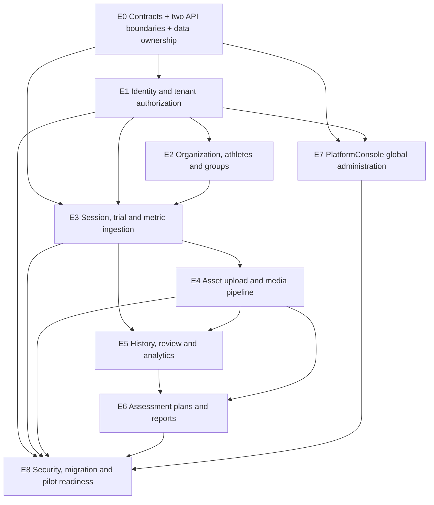

# KWinHub MVP V1.0 — Detailed Implementation Backlog

**Document type:** Product / Engineering Delivery Plan  
**Version:** 1.1  
**Status:** Proposed execution baseline — subject to G0 scope and contract freeze  
**Date:** 2026-11-03  
**Repository:** `kongdf123/KWinHub.MVP`  
**Product baseline:** KWinHub MVP PRD V1.2 Revision 2 (2026-11-03)  
**Architecture reference:** KWinHub Project Blueprint V0.3 and ADR-0001  
**Confirmed application boundary:** Option A — PlatformConsole is for global platform administration; Web.React is the customer-facing Hub. **Backend decision:** two independent API projects/deployment units — Platform.Api for PlatformConsole and Hub.Api for Web.React/client apps.

> This document translates the current PRD and architecture direction into an executable backlog. It does not claim that listed features are already implemented or that unresolved decisions are approved. P0 scope becomes a delivery commitment only after the relevant G0 review.

## 1. Purpose and delivery principles

The objective of KWinHub MVP V1.0 is to prove a real end-to-end workflow using **KWinPerformance / sports-performance iOS 2.0** as the first reference client:

**Organization and athlete identity → client-side test and calculation → reliable session/metric synchronization → independent asset upload → athlete history and review → assessment plan and report → authorized online video playback and export.**

The first release should be a useful, pilot-capable product, not a broad feature clone of a mature competitor.

### 1.1 Agreed application boundaries

| Application / service | Responsibility | Must not become |
|---|---|---|
| **KWinHub.PlatformConsole** | Internal global platform administration; calls Platform.Api only | A customer portal or a client of Hub.Api |
| **KWinHub.Web.React** | Customer-facing organization workspace; calls Hub.Api only | A platform-operator console or a client of Platform.Api |
| **KWinHub.Platform.Api** | Platform lifecycle, platform users/roles, global catalogs, platform audit and operations | Customer athlete/session/report/media workflows |
| **KWinHub.Hub.Api** | Organization membership/roles, athletes/groups, testing, ingestion, metrics, assets/media, history, plans/reports, exports/playback | Global organization lifecycle and platform operations |
| **KWinHub.Workers** | Durable asynchronous media and report processing | A cloud scientific calculation engine for V1 App-produced metrics |

The frontends do not share one backend API project. PlatformConsole calls Platform.Api; Web.React and approved client Apps call Hub.Api. The APIs may share an identity provider and small infrastructure libraries, but must have independent hosts, OpenAPI contracts, audiences/scopes/policies, configuration, health checks, deployment/release pipelines, and data ownership. Organization context shown in a frontend is not proof of authorization; Hub.Api must resolve and validate current membership, organization lifecycle status, and resource ownership.

### 1.2 Non-negotiable V1 principles

1. The existing client App remains responsible for device acquisition, local persistence, and established scientific calculations. KWinHub stores, validates, displays, and performs approved basic statistics; it does not silently recalculate scientific metrics.
2. Structured session/metric ingestion and file/video upload are independent workflows. Accepted metrics remain available when a video is pending, failed, or processing.
3. Stable client-generated identifiers, idempotency, retry, and status-query behavior are part of the ingestion contract.
4. A result retains its metric definition, unit, source, protocol, and algorithm provenance.
5. Tenant authorization applies to APIs, child resources, downloads, exports, playback credentials, callbacks, and background jobs.
6. Database state is authoritative for business status. MQ is a delivery mechanism, not the system of record.
7. Use two independently deployable API projects, each internally modular (lightweight DDD), PostgreSQL, private object storage, managed MQ, Outbox, and separate Workers. Two API hosts do not mean full microservices. Add infrastructure complexity only when justified.
8. Platform and Hub own separate schemas/DbContexts/migrations and may initially share one PostgreSQL cluster. Cross-context integration uses versioned contracts, Outbox, idempotent consumers, retry, and reconciliation; no distributed transactions.
9. Redis/distributed cache is optional and evidence-driven, not a prerequisite for the two-API design.
8. Every issue needs observable acceptance evidence; a mock screen or static chart is not proof of a working business workflow.

## 2. Priority, ownership, and delivery gates

### 2.1 Priority definitions

- **P0:** Required for the agreed V1 pilot/exhibition acceptance path or a critical dependency.
- **P1:** Valuable but should not delay the first real data loop.
- **D (Decision):** Requires product, security, or infrastructure approval before scope or implementation is committed.
- **Conditional P0:** Required only if the selected exhibition workflow or pilot explicitly needs it.

### 2.2 Delivery gates

| Gate | Proposed window | Required exit evidence |
|---|---|---|
| **G0 — Scope and contract freeze** | 2026-11-03 to 2026-11-30 | Selected real workflow and report sample; real payloads; role matrix; API contract; video specification; capacity model; migration scope; P0 acceptance tests reviewed |
| **G1 — Real data loop** | 2026-12-01 to 2026-12-31 | Real iOS session, trials, and metrics accepted and queryable; retries do not duplicate records; authorized Web.React user can inspect data; independent asset upload/verification works |
| **G2 — Review and reports** | 2027-01-01 to 2027-01-31 | History, basic comparison, selected versioned assessment plan, online report, agreed exports, and authorized playback of Ready videos |
| **G3 — Pilot readiness** | 2027-02-01 to 2027-02-28 | P0 acceptance suite passes; tenant/security, failure recovery, backup/restore, migration rehearsal, load tests, UAT, and operational runbooks completed |

**Schedule qualification:** These are planning windows derived from PRD V1.2, not an approved staffing commitment. The February 2027 target is inferred from the meeting's “February end / March exhibition” language; confirm the event date, release meaning, staffing, and migration scope before treating dates as committed. A pilot-ready build is not automatically a full commercial launch or a commitment to migrate every customer.

### 2.3 Suggested owners

Assign named people during sprint planning. Role labels below are functional placeholders.

| Workstream | Accountable role | Main contribution |
|---|---|---|
| Product and workflow | Product owner | P0 scope, exhibition workflow, metric/report semantics, decision log |
| Backend/domain | Backend lead | API, domain, persistence, tenant authorization, ingestion |
| Web.React | Frontend lead | Customer workflows, real API integration, data presentation |
| PlatformConsole | Platform frontend/operations lead | Global administration and operational views |
| iOS integration | Client App lead | Payloads, stable IDs, offline queue, retries, asset upload |
| Media infrastructure | Backend/DevOps lead | OSS, MQ, Outbox, Worker, VOD, playback |
| QA/security | QA lead with engineering | Contract, E2E, tenant isolation, recovery, performance |
| Migration/operations | Data/DevOps lead | Inventory, mapping, rehearsal, deployment, backup/restore |

## 3. Epic overview

| Epic | Name | Priority | Main outcome | Gate |
|---|---|---:|---|---|
| E0 | Requirements, API contracts, two-API foundation | P0 | Independently testable Platform/Hub contracts, data ownership, and delivery foundation | G0 |
| E1 | Authentication, organization context, authorization | P0 | Trusted identity and tenant boundary | G0–G1 |
| E2 | Organization workspace, athletes, groups | P0 | Real customer organization and athlete management | G1 |
| E3 | iOS session, trial, and metric ingestion | P0 | Reliable structured-data ingestion | G1 |
| E4 | Independent asset upload and media pipeline | P0 | Verified assets, recoverable processing, authorized playback | G1–G2 |
| E5 | Athlete history, session review, basic analytics | P0 | Real-data review and comparison | G2 |
| E6 | Assessment plans and report generation | P0 | One real, versioned assessment/report workflow | G2 |
| E7 | PlatformConsole global administration | P0/P1 by capability | Internal platform operations | G1–G2 |
| E8 | Security, migration, operations, pilot readiness | P0 | Tested and supportable pilot release | Continuous; G3 |

## 4. Detailed implementation backlog

### E0 — Requirements, API contracts, and delivery foundation

**Objective:** Ensure iOS, backend, both frontends, and QA implement the same agreed business contract.

| ID | Work item | Implementation scope | Acceptance criteria | Priority |
|---|---|---|---|---:|
| E0-01 | PRD scope reconciliation | Map PRD V1.2 FR-01–FR-15 and AC-01–AC-24 to existing code, proposed changes, and tests; mark P0/P1/D | Every P0 requirement has an owner, dependency, and test evidence; unresolved items remain explicitly marked | P0 |
| E0-02 | Exhibition workflow selection | Select one real iOS 2.0 protocol/test workflow, required metrics, trial rules, assets, and report output | Approved sample session, metric set, and expected report are available to engineering and QA | P0 |
| E0-03 | Real payload collection | Collect anonymized session, trial, metric, App report, raw-data, video, and device metadata samples | Samples cover complete, partial, retry, duplicate, and versioned cases | P0 |
| E0-04 | API contract baseline | Define versioned schemas, validation rules, idempotency, errors, status queries, upload authorization, and asset completion | OpenAPI contract is reviewed by client, backend, frontend, and QA owners | P0 |
| E0-05 | Typed frontend API clients | Generate/maintain separate TypeScript clients from the respective Platform.Api and Hub.Api OpenAPI specs | PlatformConsole imports only Platform API types/client; Web.React imports only Hub API types/client; contract drift is detectable in CI | P0 |
| E0-06 | Development environment | Document local API, PostgreSQL, object storage, and queue setup; isolate development secrets | New developer can start the system without production credentials | P0 |
| E0-07 | CI baseline | Backend build/tests, frontend lint/type-check/build, migration checks, dependency and secret scanning | Pull request checks fail on required build, type, test, or security failures | P0 |
| E0-08 | Decision register | Track identity provider, exhibition plan, payload, roles, video policy, cloud products, exports, subscription, migration, and capacity | Every decision has an owner, due date, status, and recorded rationale | P0 |
| E0-09 | Define Platform/Hub API ownership | Freeze endpoint ownership, caller matrix, separate OpenAPI specs, audiences/scopes, independent host configuration/health/deployment | PlatformConsole calls only Platform.Api; Web.React and approved Apps call only Hub.Api; no ambiguous endpoint ownership remains | P0 |
| E0-10 | Define data ownership boundaries | Establish Platform and Hub schemas, DbContexts, migrations, DB principals/permissions, and architecture tests | Each context writes only its own tables; cross-context direct writes and shared giant DbContext are blocked | P0 |
| E0-11 | Implement organization lifecycle integration | Versioned Platform→Hub organization lifecycle events, transactional Outbox, idempotent consumer, retry, reconciliation, and critical suspension behavior | Organization activation/suspension converges reliably; stale status cannot silently authorize critical operations; no distributed transaction | P0 |
| E0-12 | Independent API deployment foundation | Separate build/publish artifacts, environment configuration, health checks, OpenAPI, observability, rate limits, rollback and CI gates | Each API can be deployed/rolled back independently without requiring the other API to be released | P0 |

**Contract design rules**

- Use stable client-generated IDs for sessions, trials, and assets. Do not rely only on server-generated IDs for offline retry.
- Define idempotency semantics for duplicate and concurrent submissions, and distinguish retry from correction/revision.
- A metric definition should have a stable code, display name, value type, unit, definition/version, and applicable context.
- Preserve source App/version, device identity/model, protocol version, algorithm version, and timestamps where provided by the real client.
- Do not design the API by copying the React demo model. The domain contract is authoritative; frontends adapt to it.

**Suggested artifacts:** `docs/product/v1-scope-and-requirements-matrix.md`, `docs/api/ios-ingestion-contract-v1.yaml`, anonymized payload fixtures, and an API error/status catalog.

### E1 — Authentication, organization context, and authorization

**Objective:** Implement a server-enforced security boundary before expanding customer workflows.

| ID | Work item | Implementation scope | Acceptance criteria | Priority |
|---|---|---|---|---:|
| E1-01 | Identity-provider decision | Select managed OIDC/OAuth identity or formally approve the current identity implementation after security review | Issuer, audience, signing-key rotation, token lifetime, login/logout, account lifecycle, and recovery are documented | P0/D |
| E1-02 | Authentication integration | Configure production token validation independently in Platform.Api and Hub.Api; define distinct audiences/scopes and remove development token issuance/configuration from production | Invalid, expired, wrong-issuer, wrong-audience, and wrong-scope tokens are rejected by the correct API | P0 |
| E1-03 | User and membership model | Complete User, OrganizationMembership, membership status, and role resolution | A user may belong to multiple organizations with independent roles | P0 |
| E1-04 | Active organization context | Resolve current organization through authenticated membership and server-side authorization | Changing a client-supplied organization ID cannot grant access to another tenant | P0 |
| E1-05 | Role/permission matrix | Separate platform roles from organization roles; define read/write/export/raw-asset/report/playback permissions and team scope if required | Policy tests cover every V1 role and protected resource class | P0 |
| E1-06 | Resource tenant checks | Audit list/detail/create/update/archive/delete/export/download/playback endpoints and related-object lookups | Cross-tenant requests fail consistently without exposing protected metadata or content | P0 |
| E1-07 | Platform operator authorization | Enforce platform-admin policies in Platform.Api only; separate operational access from Hub athlete-data access | Platform operator can manage permitted tenant metadata without default unrestricted access to athlete records; Hub.Api rejects platform-only tokens absent explicit policy | P0 |
| E1-08 | Audit events | Record membership/role changes, exports, sensitive downloads/playback authorization, platform changes, and other agreed sensitive actions | Audit contains actor, organization, action, target, timestamp, and outcome; no token/secret is logged | P0 |
| E1-09 | Revocation behavior | Define effect of member suspension, role changes, organization suspension, and issued media credentials | New requests enforce updated permissions; credential expiry/revocation behavior is documented and tested | P0 |

**Security rule:** An organization ID in a JWT claim or request header is not sufficient proof of current access. Validate active membership and resource ownership. Apply the same rule to signed object-storage links, exports, queue messages, callbacks, and Workers.

### E2 — Customer workspace, athletes, and groups (Web.React)

**Objective:** Make Web.React the real customer-facing Hub rather than a demo-data showcase.

| ID | Work item | Implementation scope | Acceptance criteria | Priority |
|---|---|---|---|---:|
| E2-01 | Authenticated app shell | Authenticated routes, organization selector/context, permission-aware navigation, loading/error/empty states | Protected routes require authentication and authorized organization context | P0 |
| E2-02 | Athlete list | API-backed search, pagination, status, and agreed filters | Only authorized organization/team athletes are returned | P0 |
| E2-03 | Athlete profile | Create, edit, view, archive, restore if approved, and stable external identity | Changes persist through API and remain correct after refresh | P0 |
| E2-04 | Cross-App identity mapping | Map source App athlete IDs to Hub Subject IDs; define ambiguous/conflict handling | No automatic merge by name, phone, or email; ambiguous mappings require authorized resolution | P0 |
| E2-05 | Team/group management | Create/edit/archive groups and manage athlete membership | Group scope and membership history are enforced consistently | P0 |
| E2-06 | Organization member UI | Organization admins inspect members and roles; support approved invitation/provisioning flow if included | Non-admin users cannot add members or elevate roles | P0/Conditional |
| E2-07 | Athlete archive/retention | Define soft archive, restoration, dependencies, deletion and retention behavior | Historical sessions/reports remain traceable; archived athletes are not presented as active | P0 |
| E2-08 | Customer navigation | Implement Overview, Athletes, Testing, Analysis, Plans & Reports, Data & Synchronization, Settings | Customer tasks are discoverable; infrastructure terminology is not the primary navigation | P0 |

**Do not expand V1 into:** a complete CRM, complex multi-level team hierarchy, personal consumer portal, or three separate government/institution/personal frontends.

### E3 — iOS session, trial, and metric ingestion

**Objective:** Accept real App-calculated test data reliably and preserve scientific provenance.

| ID | Work item | Implementation scope | Acceptance criteria | Priority |
|---|---|---|---|---:|
| E3-01 | Domain-model fit review | Review MeasurementSession, Result, Metric, Protocol, Subject, and organization relationships against real payloads | Model supports the selected workflow without losing source semantics | P0 |
| E3-02 | Trial entity and contract | Add trial identity, ordering, timestamps, status, metadata, and result association as required | Trials can be retrieved individually; repeated submission does not duplicate a trial | P0 |
| E3-03 | Metric definition/value separation | Separate reusable versioned metric definitions from measured values | Historical values retain the exact applicable definition and unit | P0 |
| E3-04 | Source/device provenance | Preserve App/source version, device identity/model, protocol and algorithm version, and relevant configuration | Every accepted session is traceable to source and versions supplied by the client | P0 |
| E3-05 | Session ingestion endpoint | Implement authenticated, versioned, tenant-scoped ingestion for session/trial/metrics | Valid payload persists and returns stable Hub IDs; invalid payload returns actionable validation errors | P0 |
| E3-06 | Idempotency and conflict policy | Stable external IDs/idempotency keys, database uniqueness, duplicate/concurrent handling, correction rules | Repeated and concurrent retries create one logical record; accepted content is not silently overwritten | P0 |
| E3-07 | Transactional persistence | Persist session, trials, metric values, and asset placeholders consistently | Failed transaction leaves no partially accepted session graph | P0 |
| E3-08 | Ingestion status API | Query by client operation/session ID and return accepted/rejected/partial outcome | Client can recover after timeout/restart without guessing whether submission succeeded | P0 |
| E3-09 | Validation and error catalog | Define missing athlete, invalid protocol, unsupported metric, unit mismatch, duplicate, and authorization errors | Client can distinguish retryable, correctable, and terminal errors | P0 |
| E3-10 | Integration tests | Real PostgreSQL tests for valid/invalid payload, duplicate IDs, concurrency, rollback, and tenant boundaries | Automated tests prove the acceptance criteria | P0 |

**Suggested logical model (validate against actual payloads before physical schema freeze):**

```text
Organization
 ├── OrganizationMembership / User
 ├── Subject (Athlete)
 ├── Team / TeamMembership
 └── MeasurementSession
      ├── SessionDevice
      ├── Trial
      │    └── Result / ResultMetricValue
      └── DataAsset
```

Potential additions such as SessionDevice, Trial, MetricDefinition, and DataAsset should be implemented when justified by the real first workflow. Avoid implementing every long-term entity in advance.

**Critical boundary:** session/metric acceptance must not wait for video upload, VOD processing, or a cloud scientific calculation job.

### E4 — Independent asset upload and media processing

**Objective:** Support raw files, App reports, and videos as separately uploaded, verified, recoverable assets.

| ID | Work item | Implementation scope | Acceptance criteria | Priority |
|---|---|---|---|---:|
| E4-01 | Asset metadata model | Asset type, tenant, subject/session/optional trial, source ID, file metadata, checksum, revision, status | Asset has stable ID and validated ownership/parent relationship | P0 |
| E4-02 | Upload authorization | Issue short-lived per-asset upload authorization for private OSS | Authorization is scoped, expires, and cannot list/access unrelated objects | P0 |
| E4-03 | Direct object upload | Client uploads directly to OSS; evaluate multipart/resumable upload for large files | Large file bytes do not pass through API server; interruption can recover safely | P0 |
| E4-04 | Server-side verification | Verify object existence, expected size/type, and appropriate checksum before accepting completion | Client completion notification alone cannot mark asset verified | P0 |
| E4-05 | Independent asset state | Track Pending, Uploading, Verifying, UploadedVerified, Failed or approved equivalent | One failed video does not invalidate accepted session/metrics or other assets | P0 |
| E4-06 | Transactional Outbox | Persist processing event in same DB transaction as verified asset state | A committed verified asset cannot lose its processing request | P0 |
| E4-07 | Managed MQ | Evaluate and integrate Alibaba Cloud SMQ or approved equivalent | Duplicate delivery is safe; outage does not lose work; retry/visibility/dead-letter behavior is tested | P0/D |
| E4-08 | Durable processing jobs | Job ID/key, retry count, lease/heartbeat, failure reason, idempotency, and state transitions | Worker crash/redelivery cannot create duplicate logical jobs | P0 |
| E4-09 | VOD processing | Register eligible videos, submit media processing, persist provider IDs, and handle ambiguous outcomes | Reconciliation checks provider state before repeating uncertain external side effects | P0 |
| E4-10 | Callback and reconciliation | Authenticate provider callbacks; reconcile missed/out-of-order callbacks through provider status queries | Old callbacks cannot overwrite newer asset revisions; missed callbacks are eventually corrected | P0 |
| E4-11 | Playback authorization | Re-check organization/report/subject/asset permissions before issuing short-lived credentials | Unauthorized user cannot obtain new playback credentials; expiry renewal requires re-authorization | P0 |
| E4-12 | Web.React media states | Show per-asset upload/processing state and player only for Ready assets | Metrics remain accessible while video is pending/failed; each video has its own status | P0 |
| E4-13 | Retry and cleanup | Retry failed assets; clean stale multipart uploads and abandoned temporary objects under retention policy | Retry does not duplicate session or create an unintended second valid asset revision | P0 |
| E4-14 | Media operations | Queue backlog, job latency, failures, provider errors, storage and playback metrics | Operators can find stuck jobs and safely replay eligible work | P0 |

**Keep status dimensions separate:**

| Dimension | Example states | Meaning |
|---|---|---|
| Session ingestion | LocalOnly, Submitting, Accepted, Failed | Structured test data acceptance |
| Asset upload | Pending, Uploading, Verifying, UploadedVerified, Failed | Transfer and object verification |
| Media processing | NotRequested, Queued, Processing, Ready, Failed | Video/media readiness |
| Report | Draft, Generated | Report lifecycle |

The exact state names and transitions must be frozen in the API contract. Do not collapse all four into a generic SessionStatus.

**Worker boundary:** remove scientific ResultSimulator behavior from the production workflow. Keep simulation only as an isolated demo/test fixture. V1 Workers handle media and report tasks, not authoritative App scientific metric calculation.

### E5 — Athlete history, session review, and basic analytics

**Objective:** Provide useful, accurate review of persisted data in Web.React.

| ID | Work item | Implementation scope | Acceptance criteria | Priority |
|---|---|---|---|---:|
| E5-01 | Athlete history API | Filter sessions by athlete, date, protocol, and status with pagination | Results are tenant-scoped and pagination/sorting are stable | P0 |
| E5-02 | Session detail API | Return session, protocol/source/device metadata, trials, metrics, and asset states | Values reflect persisted backend data, not demo defaults | P0 |
| E5-03 | Replace demo services | Replace demo-backed athlete/session/result/report P0 paths with real API calls | Production mode never silently falls back to demo data after API failure | P0 |
| E5-04 | Remove fabricated mapper defaults | Do not invent sex, units, metric values, trials, quality status, or other absent data | Missing values are represented as unknown/not supplied, not synthetic facts | P0 |
| E5-05 | Session review UI | Show session metadata, trial list, metric table, provenance, and asset state | Authorized reviewer can inspect a real session without database access | P0 |
| E5-06 | Metric comparability | Compare selected historical sessions only when metric definition, unit, and relevant context are compatible | Incompatible values are excluded with an explicit reason | P0 |
| E5-07 | Basic statistics | Implement only approved statistics (e.g. mean/max) with sample count and inclusion rules | Every statistic is traceable to included source records; no scientific recalculation implied | P0 |
| E5-08 | Basic visualization | Required bar charts; simple trend lines only if the selected plan requires them | Chart values match the displayed table and actual API data | P0 |
| E5-09 | Raw data access | Authorized access/download for supported raw assets where required by pilot | Raw-data permission is independently checked from summary metric permission | Conditional P0 |
| E5-10 | UX state coverage | Loading, empty, partial, failed, unauthorized, and stale-data states | API failure is not misrepresented as an empty successful result | P0 |

### E6 — Assessment plans and report generation

**Objective:** Deliver one real, versioned assessment plan and a traceable report.

| ID | Work item | Implementation scope | Acceptance criteria | Priority |
|---|---|---|---|---:|
| E6-01 | Protocol/plan distinction | Model a single TestProtocol separately from a multi-test AssessmentPlan | API, persistence, and UI distinguish the concepts | P0 |
| E6-02 | Plan versioning | Draft/published/retired versions; published versions immutable | Updating a plan does not silently change previously generated reports | P0 |
| E6-03 | Plan composition | Required protocols/metrics, selection rules, and missing-data behavior | Selected exhibition plan validates real sessions | P0 |
| E6-04 | Candidate session query | Find eligible sessions for an authorized athlete and date range | Only sessions in the permitted organization/person scope are selectable | P0 |
| E6-05 | Explicit selection | User confirms included sessions/trials and any plan-defined selection rules | Report records exact included source IDs and selection rule | P0 |
| E6-06 | Completeness validation | Detect missing metrics/trials, incompatible versions/units, and unavailable assets | Missing values are shown explicitly and never treated as zero | P0 |
| E6-07 | Report snapshot/generation | Persist plan version, selected source IDs, metric values/units, and generation metadata | Report is traceable to exact inputs and plan version | P0 |
| E6-08 | Online report | Render metric summaries, charts, provenance, and media status in Web.React | User can review report without relying on static demo or PDF | P0 |
| E6-09 | Video embedding | Embed authorized playback for Ready assets; display state otherwise | Non-Ready video does not block metrics/report review | P0 |
| E6-10 | PDF export | Implement approved Chinese-capable PDF template | Chinese text, units, tables, pagination, and values render correctly | P0/D format |
| E6-11 | Structured export | CSV baseline; decide XLSX separately | Export matches visible selection and enforces same authorization/data masking | P0 CSV; XLSX D |
| E6-12 | Audit and retention | Record generator, plan version, inputs, export events, and report lifecycle | Historical report is traceable; snapshot/immutable inputs preserve what was generated | P0 |

**Scope restraint:** Build one fixed exhibition plan and its report first. Do not build a generic drag-and-drop report designer, formula engine, or BI platform in V1.

### E7 — PlatformConsole global administration

**Objective:** Provide internal platform governance without duplicating the customer Hub.

| ID | Work item | Implementation scope | Acceptance criteria | Priority |
|---|---|---|---|---:|
| E7-01 | Console scope/navigation | Dashboard, Organizations, Platform Users, Global Catalogs, Security & Audit, Operations; subscriptions only if required | No customer athlete/session/report workflow is duplicated | P0 |
| E7-02 | Real authentication | Use approved identity source and platform-admin policy | Non-platform users cannot access Console administration APIs | P0 |
| E7-03 | Mock/API separation | Make production explicitly API-only; keep mocks local/demo/test-only | Production build cannot silently switch to mock data | P0 |
| E7-04 | Organization lifecycle | Create, inspect, activate, suspend, and manage tenant metadata | Each action is authorized and audited | P0 |
| E7-05 | Platform user administration | Search users, inspect membership, deactivate/provision under controlled policy | Platform staff cannot silently grant themselves customer roles | P0 |
| E7-06 | Global catalogs | Manage global protocol/metric/device definitions and algorithm metadata | Version changes are auditable and do not rewrite historical results | P0 |
| E7-07 | Subscription center | Decide whether plan, quota, feature override, and usage ledger are needed for pilot | Capability is either accepted with scope or explicitly deferred | D/P1 |
| E7-08 | Audit and operational views | Search audit and processing failures with least-privilege data access | Operational visibility does not imply unrestricted athlete-data browsing | P0 |
| E7-09 | Workflow Explorer | Keep as internal development/demo utility | Simulated workflows are visibly distinguished from production state | P1 |

### E8 — Security, migration, operations, and pilot readiness

**Objective:** Make the pilot secure, recoverable, observable, and supportable.

| ID | Work item | Implementation scope | Acceptance criteria | Priority |
|---|---|---|---|---:|
| E8-01 | Tenant isolation suite | API integration tests for every tenant-scoped resource and related lookup | Cross-tenant read/write/download/export/playback attempts fail as specified | P0 |
| E8-02 | Database migrations | Constraints, indexes, FK/delete behavior, uniqueness, migration/rollback strategy | Clean DB migrates; representative existing data migrates safely | P0 |
| E8-03 | Test strategy | Unit, PostgreSQL integration, contract, authorization, and Playwright E2E tests | CI runs login → athlete → session → metrics → report critical path | P0 |
| E8-04 | Observability | Correlated request IDs, structured logs, metrics, traces, health checks | Failure can be traced from client operation through API, DB, queue, worker, and provider | P0 |
| E8-05 | Operations dashboard/alerts | Ingestion errors, Outbox/MQ backlog, worker failures, VOD latency, storage, export failures | Alert thresholds and response actions are documented | P0 |
| E8-06 | Backup/restore | DB and object-storage backup, deletion tracking, restore procedure | Restore rehearsal verifies records and referenced assets together | P0 |
| E8-07 | Migration inventory | Inventory legacy DBs, App data, identities, files, IDs, and owners | Scope, mapping, conflicts, and retention rules are documented | P0 |
| E8-08 | Trial migration | Migrate representative sample; verify counts, relationships, files, and checksums | Re-run is idempotent; discrepancies are explainable | P0 |
| E8-09 | Cutover/rollback plan | Client rollout, old/new write routing, final delta, monitoring, rollback trigger | No production cutover without tested rollback path | P0 |
| E8-10 | Capacity model | Separate API RPS, concurrent uploads, bandwidth, playback concurrency, worker throughput, and storage growth | “300 organizations / 1,000 concurrent users” is translated into measurable load scenarios | P0 |
| E8-11 | Load/resilience tests | Agreed traffic, upload interruption, MQ outage, worker crash, callback loss, provider timeout | Frozen performance and recovery targets are met | P0 |
| E8-12 | Pilot/UAT/runbooks | Operator/user guide, test scripts, demo dataset, known limitations, support procedure | Product, engineering, and QA sign off one acceptance checklist | P0 |

**Deployment direction:** Maintain two independent .NET API projects (Platform.Api and Hub.Api), each internally modular, with PostgreSQL as transactional source of truth. Start with one PostgreSQL cluster but separate schemas, DbContexts, migrations, and database write permissions. Use private object storage, managed MQ, Outbox, and separate Workers. Do not expand into per-module microservices or introduce Kafka/Kubernetes without measured justification. Redis is optional and requires a demonstrated use case. Cross-context integration is asynchronous/versioned and idempotent; do not use distributed transactions. Confirm Alibaba Cloud product, region, compatibility, limits, and cost through a working proof of concept.

## 5. Dependency map and execution order



### 5.1 Critical path

1. Select the exhibition workflow and collect real payloads.
2. Freeze identity, tenant, and API contracts.
3. Persist one athlete, session, trials, and App-calculated metrics.
4. Replace the Web.React demo path for athlete/session/result with real APIs.
5. Demonstrate real session metrics in Web.React.
6. Add independent asset upload, verification, and asynchronous media processing.
7. Add history/comparison and the selected report workflow.
8. Complete playback authorization, recovery, migration rehearsal, and pilot hardening.

Do not wait for VOD to finish before proving structured ingestion. Do not declare the full V1 workflow complete until required video playback and recovery scenarios pass.

### 5.2 Parallel workstreams

| Workstream | Initial scope | Start condition |
|---|---|---|
| Backend/domain | E0, E1, E2, E3, E4, E6 | Start immediately; contract and authorization decisions first |
| Web.React | E0, E2, E5, E6 | Shell/API client can start while backend contracts are reviewed |
| PlatformConsole | E0, E1, E7 | Audit scope/mock coverage and prepare real admin APIs |
| iOS integration | E0, E3, E4 | Real payload and retry/upload contract agreed |
| Media/DevOps | E0, E4, E8 | Validate OSS/MQ/VOD and build integration proof of concept |
| QA/security | E0, E1, E3, E4, E8 | Write acceptance and threat tests before feature completion |
| Migration | E8 | Inventory/mapping can begin immediately; execution follows schema freeze |

## 6. First four weeks — proposed execution slice

| Week | Dates | Backend / integration | Web.React | PlatformConsole / QA |
|---|---|---|---|---|
| W1 | Nov 3–9 | Inventory domain/API; confirm identity/tenant decisions; collect iOS payloads | Map screens to PRD; identify demo dependencies | Confirm Console boundary; map mock/API coverage; draft test matrix |
| W2 | Nov 10–16 | Finalize session/trial/metric/asset contracts and idempotency | Build authenticated shell/API client; align types and navigation | Define platform policies; identify admin endpoints; add auth test cases |
| W3 | Nov 17–23 | EF migrations, tenant integration tests, first ingestion endpoint | Connect athlete list/profile to real APIs | Connect organization/user admin paths where APIs exist; CI checks |
| W4 | Nov 24–30 | Complete first ingestion slice and asset contract; G0 review | Display real athlete/session/metric data | Validate platform access boundaries; run cross-tenant tests |

**Weekly demonstration rule:** demonstrate working software and test evidence every week. A completed UI wired to a mock is not completion of an API integration issue.

## 7. Repository implementation map

The paths below are initial investigation/implementation locations based on the current repository review. Verify exact class names and project structure before assigning file-level subtasks.

| Area | Repository path | Expected change |
|---|---|---|
| Platform API host | `src/backend/KWinHub.Platform.Api/` (target structure) | Platform policies, global organization lifecycle, platform OpenAPI, independent config/health/deployment |
| Hub API host | `src/backend/KWinHub.Hub.Api/` (target structure) | Hub policies, tenant context, ingestion/business endpoints, Hub OpenAPI, independent config/health/deployment |
| Platform persistence | `src/backend/KWinHub.Platform.Infrastructure/Persistence/` (target structure) | Platform schema, DbContext, migrations and DB permissions |
| Hub persistence | `src/backend/KWinHub.Hub.Infrastructure/Persistence/` (target structure) | Hub schema, DbContext, migrations and DB permissions; migrate existing persistence incrementally |
| Domain sessions | `src/backend/KWinHub.Domain/Sessions/` | Session/trial/device relationships |
| Domain results | `src/backend/KWinHub.Domain/Results/` | Metric definition/value separation and provenance |
| Domain organizations | `src/backend/KWinHub.Domain/Organizations/` | Membership and role model |
| Application | `src/backend/KWinHub.Application/` | Ingestion, asset, report, authorization-aware services |
| Contracts | `src/backend/KWinHub.Contracts/` plus Platform/Hub contract folders (target structure) | Explicit API DTOs and versioned Platform→Hub event contracts; avoid shared domain models |
| Shared building blocks | `src/backend/KWinHub.BuildingBlocks/` (target structure) | Logging, tracing, message envelope, identity abstractions and cross-cutting primitives only; no shared domain entities/repositories |
| Workers | `src/backend/KWinHub.Workers/` | Durable media/report jobs; isolate demo scientific simulator |
| PlatformConsole client | `src/frontend/KWinHub.PlatformConsole/src/lib/api.ts` | API-only production configuration and global admin APIs |
| Web.React services | `src/frontend/KWinHub.Web.React/src/lib/services.ts` | Replace demo P0 services with real API calls |
| Web.React API/types | `src/frontend/KWinHub.Web.React/src/lib/api/`, `src/lib/types.ts` | Contract-aligned types/client |
| Tests | `tests/` | PostgreSQL integration, contract, tenant authorization, E2E |
| Deployment | `deploy/` | Production secrets, health checks, Worker, queue, object storage |

### 7.1 Known code-review risks to verify and address

- PlatformConsole's `VITE_USE_MOCK_API` default was observed as `true`; production must be explicitly API-only.
- Web.React's `VITE_DATA_MODE` supports demo mode; production must not silently use demo data.
- Some Web.React mappers were observed to fill absent values with defaults. Remove fabricated values and represent missing/unknown data explicitly.
- JWT bearer middleware and a current-user context are present, but the final identity provider and complete tenant isolation are not thereby proven.
- A scientific `ResultSimulator` exists in the Worker path; isolate it as demo/test-only and do not use it as the production scientific source.
- Re-audit these observations against the current default branch before implementation; code may have changed since the review.

## 8. GitHub project management

### 8.1 Suggested milestones

- `G0 — Scope & Contracts — 2026-11`
- `G1 — Real Data Loop — 2026-12`
- `G2 — Review & Reports — 2027-01`
- `G3 — Pilot Readiness — 2027-02`

### 8.2 Suggested labels

`epic`, `priority:P0`, `priority:P1`, `area:backend`, `area:web-react`, `area:platform-console`, `area:ios-integration`, `area:media-worker`, `area:qa-security`, `blocked`, `decision-required`.

### 8.3 Issue template

```markdown
## Objective
What user or system outcome does this issue deliver?

## Scope
- Included:
- Excluded:

## Dependencies
- Related issue IDs:
- Required product/technical decisions:

## Implementation notes
- Relevant projects/files:
- API/domain/database changes:
- Frontend/worker changes:

## Acceptance criteria
- [ ] ...
- [ ] ...

## Test evidence
- Unit:
- Integration:
- E2E:
- Security/recovery:

## Documentation
- API / schema / runbook updates:
```

Create one parent issue per epic and child issues per independently testable work item. Do not create one oversized issue such as “connect React to backend”.

## 9. V1 Definition of Done

KWinHub MVP V1.0 is ready for the agreed pilot only when all applicable P0 gates below have evidence:

| Gate | Required evidence |
|---|---|
| Identity | Real authentication and organization membership enforcement |
| Tenant isolation | No cross-tenant access through API, child resources, files, exports, playback, or background jobs |
| Ingestion | Real iOS session, trials, and metrics accepted and persisted |
| Reliability | Timeout, duplicate submission, retry, and App restart do not duplicate logical records |
| Scientific provenance | Source, protocol, algorithm version, units, and metric definitions are traceable; no silent Hub scientific recalculation |
| Asset lifecycle | Independent upload, server verification, status, and failure recovery |
| Media | Ready video plays with authorized short-lived credentials; non-Ready media does not block metrics |
| Review | Athlete history, session detail, and approved basic comparisons use real backend data |
| Reports | Selected plan produces traceable report with correct values, units, missing-data handling, and plan version |
| Export | Approved exports respect authorization/masking and render Chinese correctly |
| PlatformConsole | Platform operators can perform approved global administration |
| Operations | Monitoring, alerting, backup/restore, recovery, and pilot runbooks tested |

## 10. Open decisions and due dates

| ID | Decision | Recommended starting point | Target |
|---|---|---|---|
| D-01 | Identity provider | Prefer managed OIDC/OAuth; approve custom identity only after security review | Nov 9 |
| D-02 | Exhibition plan/report | One real iOS 2.0 workflow and fixed metric/report sample | Nov 9 |
| D-03 | iOS payload | Anonymized real payloads, not frontend-invented schemas | Nov 16 |
| D-04 | Organization roles/scope | Platform Admin, Organization Admin, Coach/Scientist, Operator; confirm team scope | Nov 16 |
| D-05 | Video specification | Format, max size/duration, upload, retention, playback concurrency | Nov 16 |
| D-06 | Export formats | PDF and CSV baseline; XLSX decision separate | Nov 23 |
| D-07 | Alibaba Cloud services | Validate OSS, VOD, SMQ, region, SDK/.NET compatibility, limits, and cost | Nov 23 |
| D-08 | Subscription center | Defer unless pilot/commercial operations require it | Nov 30 |
| D-09 | Migration scope | Confirm sample rehearsal vs. actual customer cutover and batches | Nov 30 |
| D-10 | Capacity targets | Turn 300 organizations / 1,000 concurrent users into API/upload/playback/worker scenarios | Nov 30 |

## 11. Immediate next actions

1. Create the G0 milestone and E0/E1/E3 parent issues.
2. Assign owners for the exhibition workflow, real iOS payloads, identity decision, and video specification.
3. Hold a joint contract review with App, backend, Web.React, PlatformConsole, and QA.
4. Implement the first vertical slice: authenticated athlete → session/trial/metric ingestion → persisted data → Web.React review.
5. Add acceptance tests before expanding the UI or implementing generic administration features.

**Current status:** This document defines the proposed backlog and delivery baseline. It does not claim that GitHub issues have been created, code has been changed, or builds/tests have been run.
