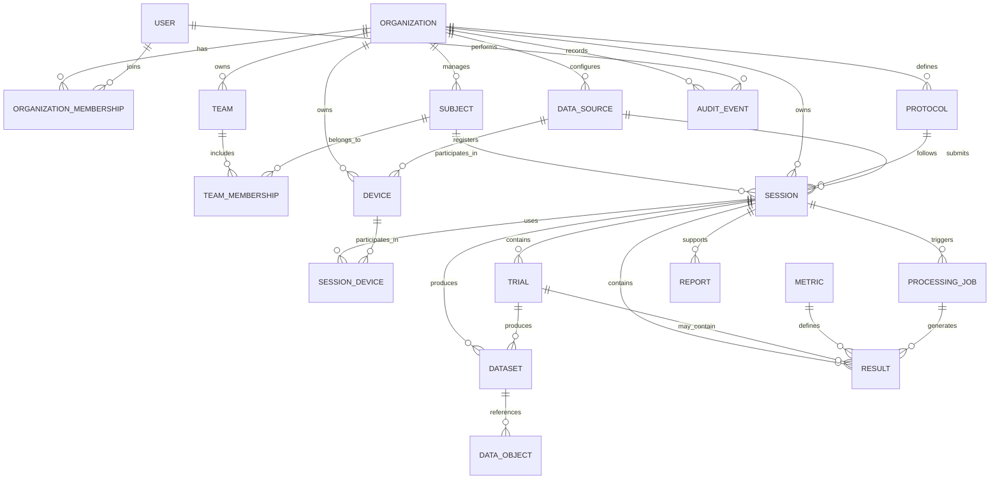

# KWinHub 2.0 — MVP Product Requirements Document

**Version:** 1.1
**Status:** Draft for review
**Product owner:** Kunwei Sports
**Scope:** First production-capable version of the KWinHub platform

## 1. Executive Summary

### 1.1 Product vision

KWinHub is Kunwei's unified sports-performance data platform. It connects Kunwei's hardware, desktop and mobile applications, scientific calculation capabilities, and athlete-performance records.

The platform will provide a common foundation for collecting, storing, processing, reviewing, and sharing sports-performance data across Kunwei products.

### 1.2 Strategic positioning

International competitors such as VALD, Kinvent, Hawkin Dynamics, and Output Sports demonstrate the strategic value of combining measurement hardware, standardized testing workflows, scientific calculations, longitudinal athlete data, and reporting.

Kunwei's opportunity is to build a similar integrated ecosystem around its own strengths, including force measurement, sprint testing, timing, video, and sports-science calculations.

The intended architecture is:

**Kunwei devices → Client applications → KWinHub → KWinScience / processing capabilities → Athlete history, analysis, and reports**

KWinHub should become the shared data and platform layer. Existing client applications should continue to handle specialized acquisition workflows rather than being rewritten as part of the MVP.

### 1.3 MVP objective

Prove one complete end-to-end workflow:

**Create athlete → Conduct a test in an existing Kunwei client → Synchronize data to KWinHub → Review results → Compare historical measurements → Export a basic report.**

The MVP must also establish secure multi-organization access, a reusable data model, reliable ingestion, and an integration pattern that future Kunwei products can adopt.

### 1.4 Target users

| User                       | Primary needs                                                       |
| -------------------------- | ------------------------------------------------------------------- |
| Organization administrator | Manage organization members, roles, and access                      |
| Coach / sports scientist   | Review athletes, test results, and historical trends                |
| Testing operator           | Conduct tests and verify data synchronization                       |
| Researcher / analyst       | Inspect measurements and scientific results, subject to permissions |
| Platform administrator     | Monitor platform health and troubleshoot authorized issues          |

---

## 2. Product Scope and Priorities

The MVP should be defined by the first real customer workflow, not by implementing every capability that a mature competitor offers.

### 2.1 P0 — Core MVP

| Capability          | Required scope                                                                |
| ------------------- | ----------------------------------------------------------------------------- |
| Identity and access | Sign-in, organization membership, predefined roles, server-side authorization |
| Athlete management  | Create, edit, search, view, and archive athletes                              |
| Team management     | Create teams and associate athletes with teams                                |
| Protocols           | Identify the test type and retain the relevant protocol version               |
| Session management  | Create and query measurement sessions                                         |
| Trials              | Support multiple attempts within one session                                  |
| Client integration  | Integrate at least one existing Kunwei client                                 |
| Data ingestion      | Submit session metadata and structured results reliably                       |
| Metrics and results | Store metric definitions, values, units, and source context                   |
| Historical review   | View athlete history and session details                                      |
| Basic comparison    | Compare selected metrics across sessions                                      |
| Synchronization     | Track ingestion status, retry failures, and prevent duplicates                |
| Data assets         | Upload and retrieve raw files or videos if required by the first client       |
| Reporting           | Export an agreed basic report if required by the pilot                        |
| Operations          | Logging, monitoring, backup, restore testing, and audit records               |

### 2.2 P1 — Post-MVP

- Additional Kunwei client integrations.
- CSV and spreadsheet import.
- Advanced filters and dashboards.
- Rich time-series visualization.
- Advanced synchronized video review.
- Custom report templates.
- Third-party integrations and webhooks.
- Normative datasets and reference-population comparisons.
- More advanced device management.
- Advanced team-level analytics.

### 2.3 P2 — Longer-term opportunities

- Automated scientific interpretation.
- AI-assisted performance analysis.
- Cross-organization benchmarking with appropriate permissions and consent.
- Broader third-party device integration.
- Training-program management.
- Specialized analytics for additional sports and assessment domains.

### 2.4 Explicitly out of scope

- Rewriting every existing Kunwei client.
- Replacing KWinScience.
- Full remote control of every device.
- Building a complete training-management system.
- Implementing every competitor feature.
- Premature microservices decomposition.
- Active-active multi-region deployment.
- A universal analytics engine before real use cases are established.

**Scope rule:** If the first client requires a capability to complete the end-to-end workflow, it is P0 even if the broader feature is planned for a later phase. For example, raw-file upload is P0 if the pilot requires raw data to be available in KWinHub.

---

## 3. Core User Workflows

### Workflow A — Organization and athlete setup

1. An administrator provisions an organization.
2. Users are assigned to the organization with predefined roles.
3. An authorized user creates an athlete profile.
4. The user optionally assigns the athlete to a team.
5. The athlete receives a stable internal identifier.

### Workflow B — Measurement ingestion

1. The operator conducts a test using an existing Kunwei client.
2. The client identifies the athlete, protocol, data source, and session.
3. The client submits session metadata, trials, and structured results.
4. Required raw files or videos are uploaded.
5. KWinHub validates and persists the records.
6. The client receives the accepted identifiers and synchronization status.
7. Failed requests can be retried without creating duplicate logical records.

### Workflow C — Review and comparison

1. The user opens an athlete profile.
2. The user views historical sessions.
3. The user opens a session to inspect its results and available assets.
4. The user compares selected metrics across sessions.
5. The user exports the agreed report, if included in the pilot.

### Workflow D — Scientific processing

If calculations remain in the client, KWinHub stores the resulting metrics and the provenance available from the client.

If KWinHub executes calculations, it creates a processing job, tracks execution status, and records the algorithm version, configuration, input references, and outputs.

The MVP does not need a general-purpose processing engine if the first client already calculates all required metrics reliably.

---

## 4. Canonical Data Model

The data model must preserve the difference between a test event, an individual attempt, raw measurement data, scientific calculations, and reported results.

### 4.1 Core entities

| Entity                   | Responsibility                                                  | MVP priority                           |
| ------------------------ | --------------------------------------------------------------- | -------------------------------------- |
| `Organization`           | Tenant and principal data-ownership boundary                    | P0                                     |
| `User`                   | Human identity                                                  | P0                                     |
| `OrganizationMembership` | User role within an organization                                | P0                                     |
| `Subject`                | Canonical athlete/person record                                 | P0                                     |
| `Team`                   | Group of athletes                                               | P0                                     |
| `TeamMembership`         | Athlete-to-team relationship and membership history             | P0                                     |
| `Protocol`               | Versioned test or assessment definition                         | P0                                     |
| `DataSource`             | Originating client application or integration                   | P0                                     |
| `Device`                 | Physical measurement instrument                                 | P0                                     |
| `Session`                | Main testing event                                              | P0                                     |
| `SessionDevice`          | Associates devices with a session                               | P0 when multiple devices are relevant  |
| `Trial`                  | Individual attempt within a session                             | P0                                     |
| `Metric`                 | Reusable scientific metric definition                           | P0                                     |
| `Result`                 | Value or structured output for a metric                         | P0                                     |
| `Dataset`                | Logical collection of structured measurement data               | As required by the first data contract |
| `DataObject`             | Metadata and storage reference for files, videos, and artifacts | P0 if assets are ingested              |
| `ProcessingJob`          | Processing lifecycle and scientific provenance                  | Conditional P0                         |
| `Report`                 | Generated report metadata and file reference                    | P0 if reporting is in scope            |
| `AuditEvent`             | Record of important security and administrative actions         | P0                                     |

These are logical domain entities. Their exact physical tables and relationships should be confirmed against the first client's real payloads.

### 4.2 Relationship overview

The diagram is a logical model, not a finalized database schema. In particular, the relationship between results, trials, and datasets must be validated against real test outputs.

### 4.3 Key modeling decisions

**1. `Subject` is the canonical backend entity.**
The UI can call it “Athlete.” Use stable internal IDs and source-scoped external identifiers. Do not use names as unique identifiers.

**2. `Session` is the central testing event.**
It connects the athlete, protocol, source application, devices, trials, results, and assets.

**3. Raw data and results are different.**
A raw file, time series, calculated metric, and PDF report must not be treated as interchangeable records.

**4. `DataSource` and `Device` are different concepts.**
A data source is an application or integration; a device is a physical instrument. One session may involve several devices.

**5. Protocols and metrics must be versioned.**
Changes to a scientific definition must not silently change the interpretation of historical results.

**6. Every resource must have a clear tenant authorization path.**
Child records may inherit ownership from a parent, but every API query, mutation, and file-access operation must enforce the correct organization boundary.

---

## 5. Essential Data Requirements

### 5.1 Session

Minimum suggested fields:

- `id`
- `organization_id`
- `subject_id`
- `protocol_id`
- `data_source_id`
- `external_session_id`, when applicable
- `started_at`
- `completed_at`
- `status`
- `metadata`
- `created_at`

Store timestamps in UTC. Retain local-time context when it is needed to interpret the test.

### 5.2 Trial

Minimum suggested fields:

- `id`
- `session_id`
- `external_trial_id`, when applicable
- `trial_number`
- `started_at`
- `completed_at`
- `status`
- `metadata`

### 5.3 Metric and Result

A metric definition should include its stable code, name, description, data type, unit, and definition version.

A result should include:

- `id`
- `session_id`
- `trial_id`, nullable
- `metric_id`
- `processing_job_id`, nullable
- `value_type`
- `value`
- `unit`
- `source_type`
- `created_at`

Support the actual result types produced by the first client. These may include scalar numbers, categorical values, bilateral values, structured values, and time-series references. Do not assume that all results fit into one numeric column.

### 5.4 DataObject

When files are ingested, record:

- `id`
- `organization_id`
- `session_id`
- `trial_id`, nullable
- `dataset_id`, nullable
- `object_type`
- `storage_key`
- `file_name`
- `content_type`
- `size_bytes`
- `checksum`
- `upload_status`
- `created_at`

Store file contents in object storage and their metadata in the relational database. Protect retrieval with authorization and appropriately scoped, time-limited access.

### 5.5 ProcessingJob

When Hub-side processing is required, record:

- Processing status and timestamps.
- Algorithm name and version.
- Configuration version or configuration snapshot.
- Input data references.
- Output references.
- Error details.

If processing remains client-side in the first release, preserve the available calculation provenance without implementing an unnecessary processing orchestration system.

---

## 6. Client Integration and Synchronization

### 6.1 Integration principles

- Use versioned REST APIs for business operations.
- Use heartbeat for client health and control-plane information, not as the primary data-transfer mechanism.
- Support incremental synchronization where appropriate.
- Maintain a durable local outbox if clients must work offline.
- Use idempotency keys and stable external IDs.
- Upload large files directly to authorized object storage where supported.
- Validate payload schemas and versions on the server.
- Keep KWinHub authoritative for authorization.

### 6.2 Recommended synchronization sequence

1. Authenticate the client.
2. Retrieve applicable configuration and API capabilities.
3. Submit session metadata.
4. Submit trials and structured results.
5. Upload required raw files and videos.
6. Receive accepted IDs and server-side status.
7. Record successful synchronization locally.
8. Retry transient failures with bounded backoff and expose persistent failures.

A retry must reuse the original logical operation ID or idempotency key. It must not create a new session merely because a network request timed out.

### 6.3 Authentication

- Human users: managed OpenID Connect / OAuth 2.0.
- Desktop and mobile public clients: Authorization Code with PKCE where applicable.
- Machine-to-machine services: client credentials or workload identity as appropriate.
- Do not embed permanent confidential client secrets in desktop or mobile applications.
- Enforce authorization at the resource level, even after authentication succeeds.

### 6.4 Initial API groups

- Organization membership and access context.
- Athletes and teams.
- Protocols.
- Data sources and devices.
- Sessions and trials.
- Metrics and results.
- Asset upload and retrieval.
- Reports.
- Client configuration and synchronization status.

Exact endpoint paths and schemas should be defined after the first client has been selected and its payloads inspected.

---

## 7. Non-Functional Requirements

### Security

- Enforce tenant authorization on every relevant request.
- Never trust a client-supplied organization ID without checking access.
- Keep object storage private by default.
- Protect downloads and uploads with scoped authorization.
- Audit important administrative and security-sensitive operations.
- Define data retention, deletion, and export policies before production rollout.

### Reliability

- Idempotent ingestion.
- Bounded retries and backoff.
- Failure isolation for asynchronous jobs.
- Reconciliation for incomplete uploads and partially completed ingestion.
- Verified database backup and restoration.

### Scientific traceability

- Preserve protocol and metric versions.
- Record source application and relevant device context.
- Retain processing provenance when calculations run in the Hub.
- Never silently replace historical results after an algorithm change.
- Define units and meanings for the metrics included in the MVP.

### Performance and scalability

Set measurable latency, concurrency, and ingestion targets after estimating the pilot workload. Do not overbuild for hypothetical scale; maintain modular boundaries so the architecture can evolve as demand becomes clearer.

---

## 8. Recommended Technical Architecture

### 8.1 Initial implementation

| Layer                   | Recommended baseline                               |
| ----------------------- | -------------------------------------------------- |
| Web frontend            | React + TypeScript                                 |
| Backend                 | C# / ASP.NET Core on .NET 10 LTS                   |
| Data access             | Entity Framework Core                              |
| Relational database     | PostgreSQL                                         |
| Identity                | Managed OIDC / OAuth 2.0                           |
| File and video storage  | Regional S3-compatible object storage              |
| Asynchronous processing | Managed queue and worker process when needed       |
| Deployment              | Containers and CI/CD                               |
| Observability           | Structured logs, metrics, traces, error monitoring |
| Infrastructure          | Managed secrets and infrastructure as code         |

These are recommendations, not confirmed details of Kunwei's existing production infrastructure.

### 8.2 Application architecture

Start with a **modular monolith**, organized into clear modules:

- Identity and Access.
- Organization and Membership.
- Subject and Team Management.
- Device and Client Integration.
- Protocol Management.
- Sessions and Trials.
- Data Assets.
- Metrics and Results.
- Processing and Analysis.
- Reporting.
- Synchronization and Integration.
- Audit and Operations.

Use separate worker processes only when background processing or scientific calculations require them. Do not begin with microservices by default.

### 8.3 KWinScience integration

Reuse existing KWinScience capabilities wherever practical.

The first release should define a stable contract for exchanging input data, metric outputs, units, and calculation provenance. If calculations need to run in KWinHub, begin with a versioned worker interface and the existing compatible .NET code where possible.

### 8.4 International deployment

Make the architecture region-aware, but launch in one production region unless customer or regulatory requirements demand otherwise. Multi-region active-active deployment is outside the MVP.

---

## 9. Delivery Plan

### Phase 0 — Discovery and data-contract confirmation

- Select the pilot workflow and first client.
- Inspect real session, trial, result, and file payloads.
- Decide whether raw data and video must be uploaded.
- Decide where the first metrics will be calculated.
- Confirm metric and protocol versioning rules.
- Define pilot acceptance criteria.

**Exit criterion:** The team agrees on the first client integration contract and the exact end-to-end workflow.

### Phase 1 — Platform foundation

- Authentication and organization context.
- Organization memberships and predefined roles.
- Tenant-safe persistence and API patterns.
- Initial database migrations.
- CI/CD, logging, error handling, and deployment.

**Exit criterion:** Authorized users can access their resources, and cross-organization access is denied.

### Phase 2 — Data vertical slice

- Athlete and team management.
- Protocol, data source, session, and trial support.
- Initial client ingestion API.
- Metrics and results.
- Idempotency and synchronization status.
- Required asset upload.

**Exit criterion:** One real client can submit a complete test workflow and safely retry failed requests.

### Phase 3 — Review and reporting

- Athlete history.
- Session details.
- Basic result visualization and comparisons.
- Agreed report export.
- Secure asset retrieval.

**Exit criterion:** A coach or sports scientist can complete the pilot review workflow without manual database intervention.

### Phase 4 — Pilot hardening

- Tenant-isolation tests.
- Retry and reconciliation tests.
- Backup and restore validation.
- Operational dashboards and alerts.
- Pilot feedback and defect resolution.

**Exit criterion:** The MVP satisfies agreed functional, security, and operational acceptance criteria.

---

## 10. MVP Acceptance Criteria

The MVP is ready for pilot acceptance when:

- Users can sign in and access the correct organization.
- Authorized users can manage athletes and teams.
- At least one existing Kunwei client can submit sessions, trials, and results.
- Required raw files and videos can be securely uploaded and retrieved.
- Retried requests do not create duplicate logical records.
- Users can view session details and athlete history.
- Users can compare the agreed metrics.
- The agreed report can be exported if it is in pilot scope.
- Metric definitions and available scientific provenance are retained.
- Automated cross-tenant authorization tests pass.
- Logging, backup, restoration, and operational monitoring are in place.
- Pilot users can complete the intended workflow without known critical defects.

### Proposed success measures

Measure ingestion success, retry behavior, cross-tenant security, report completion, recovery readiness, and actual pilot-user adoption. Numeric targets should be agreed after the expected pilot workload is known.

---

## 11. Key Risks and Mitigations

| Risk                                               | Mitigation                                                         |
| -------------------------------------------------- | ------------------------------------------------------------------ |
| Different clients use incompatible data structures | Define a canonical contract and source-specific adapters           |
| Scientific definitions change                      | Version protocols, metrics, algorithms, and configurations         |
| Retries produce duplicate records                  | Use stable IDs, idempotency, and reconciliation                    |
| Raw files increase storage costs                   | Use object storage rather than storing file contents in PostgreSQL |
| Tenant data leaks                                  | Enforce server-side authorization and automated isolation tests    |
| Scope expands to match every competitor feature    | Keep advanced analytics, norms, and AI interpretation out of P0    |
| Existing clients are difficult to modify           | Start with one integration and a versioned API contract            |
| Infrastructure becomes unnecessarily complex       | Start with a modular monolith and managed services                 |

---

## 12. Decisions Required Before Development

1. Which existing Kunwei client will be integrated first?
2. What exact test workflow will the first pilot validate?
3. Will the first integration submit structured results only, or also raw force data, time series, and video?
4. Will calculations remain in the client or run in KWinHub?
5. How will athlete identities be mapped across legacy clients and organizations?
6. Which identity provider and initial deployment region will be used?
7. Is PDF report export mandatory for the first pilot?
8. What are the expected organizations, users, sessions, file sizes, and concurrency?
9. What are the team capacity and target release date?

These decisions determine the final schema, API contracts, and delivery estimate.

---

## 13. Final Product Principle

KWinHub should be the shared data and integration platform across Kunwei's products. Existing clients remain specialized acquisition tools; KWinScience remains the scientific calculation capability; KWinHub provides the shared identity, session, result, storage, history, and reporting foundation.

**The MVP succeeds when one real Kunwei workflow works end to end, securely and reliably, and establishes a reusable integration pattern for the next product.**
