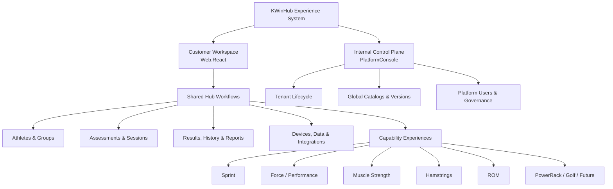

# 01 — KWinHub UI/UX Architecture

**Status:** Proposed · **Applications:** KWinHub.Web.React and KWinHub.PlatformConsole

## 1. Experience architecture

KWinHub should unify the athlete and organization experience without forcing different sports-science domains into one generic workflow.



### 1.1 Customer workspace — Web.React

Users: coaches, sports scientists, test operators, organization administrators and permitted read-only stakeholders. Owns organization-scoped work: athletes, teams/groups, sessions, protocol usage, trials, results, media, integrations, reports and organization settings.

### 1.2 Internal control plane — PlatformConsole

Users: Kunwei platform administrators, catalog managers, subscription operators where approved, and support/operations staff with explicitly granted access. Owns tenant lifecycle, platform users, global catalogs and versions, platform governance and approved platform operations. It is not an athlete-management application.

### 1.3 Capability experiences

A capability contributes specialized content to shared Hub workflows; it is not a separate application instance.

| Capability | Specialized content |
|---|---|
| Sprint | Split times, timing events, reaction outputs, speed curves and synchronized video where available |
| Force / Performance | Jump metrics, force-time curves, impulse and supported asymmetry |
| Muscle Strength | Bilateral force and limb comparisons |
| Hamstrings | Peak force/torque and repetition/event analysis |
| ROM | Body region, movement/action, position and bilateral degrees |
| PowerRack / Golf | Domain-specific measures as data contracts mature |

A module may contribute assessment renderers, athlete widgets, analytics widgets, report blocks, device/data adapters, permissions, entitlement requirements and configuration schemas. It must not redefine shared concepts such as athlete identity, organization, session, assessment, result ownership or audit semantics.

## 2. Core UX principles

1. **Athlete-centered, not application-centered.** The athlete profile is the cross-product destination. Do not make the main navigation a list of source-app brands.
2. **Shared workflow, specialized science.** Reuse page structure and interactions, but keep sprint, force, torque and ROM visualizations distinct.
3. **Progressive disclosure.** Show primary task information first; place advanced metadata, raw-data details and audit history in secondary sections.
4. **Configuration with guardrails.** Configure enabled capabilities, catalogs, widgets and saved views. Do not turn every page into a low-code builder.
5. **Honest operational feedback.** Show only server-confirmed upload, processing, health and retry states. Never present static demo data as live telemetry.

## 3. Application and API boundary

| Concern | Web.React | PlatformConsole |
|---|---|---|
| Organization athletes, teams and groups | Owns | No |
| Sessions, trials, results, assets, history and reports | Owns | No |
| Organization device inventory/assignment | Owns | Global device model catalog only |
| Organization integration instances | Owns | Integration type/policy registry |
| Organization settings and members | Owns | Platform users and tenant lifecycle |
| Global protocols, metrics and device models | Consumes published catalog | Owns |
| Tenant provisioning/suspension | No | Owns |
| Platform audit/global operations | Organization-scoped view if supported | Owns |
| Plans and global entitlements | Displays assigned plan/limits | Owns if commercial scope approved |

`PlatformConsole` calls `Platform.Api`; `Web.React` and approved client apps call `Hub.Api`. Clients must not call `Platform.Api` directly. Hub should consume a versioned published catalog read model, not read Platform's database directly.

## 4. Capability module contract

Start with statically registered frontend modules. Do not load arbitrary remote executable code.

```ts
export interface CapabilityModule {
  id: string;
  displayName: string;
  version: string;
  navigation?: NavigationContribution[];
  athleteWidgets?: AthleteWidgetContribution[];
  assessmentRenderers: AssessmentRendererContribution[];
  analyticsWidgets?: AnalyticsWidgetContribution[];
  reportBlocks?: ReportBlockContribution[];
  requiredPermissions?: string[];
  requiredEntitlements?: string[];
  configurationSchema?: JsonSchema;
}
```

Rules: stable namespaced IDs (`sprint`, `force-performance`); version module metadata and published catalog definitions; modules contribute to shared pages rather than creating duplicate athlete directories; navigation contributions are optional; server permissions/entitlements are authoritative; renderers declare supported result types and required fields; missing data yields explicit partial/unavailable states; preserve source app, device, protocol/version, timestamp and calculation provenance.

## 5. Configuration hierarchy

1. **Platform defaults:** tokens, global catalogs, capability definitions and policies.
2. **Organization configuration:** enabled capabilities, available protocols, groups, device assignments and report/dashboard defaults.
3. **Role-based experience:** permitted navigation, actions and data scope.
4. **User personalization:** favorites, saved filters, date ranges, widget order and chart preferences.

Higher-level policy wins. Personalization cannot override permissions, entitlements or data scope.

## 6. Theme architecture

Theme is a presentation preference, not a capability or authorization setting:
- `classic` — Kunwei Classic; preserve current appearance.
- `light` — Performance Light; preserve current light theme.
- `hub-light` — Performance Hub; proposed third, neutral sports-performance workspace theme.

Keep token names identical across both apps. CSS definitions may remain local initially. Persist theme independently per app. Switching theme must not reset route, filters, selections or unsaved form state, and must not require a reload.

## 7. Explicit exclusions

This document does not approve cloud-side scientific signal recalculation, microservices migration, runtime plugin marketplace, arbitrary remote JS, or copying VALD branding/assets/layout.
